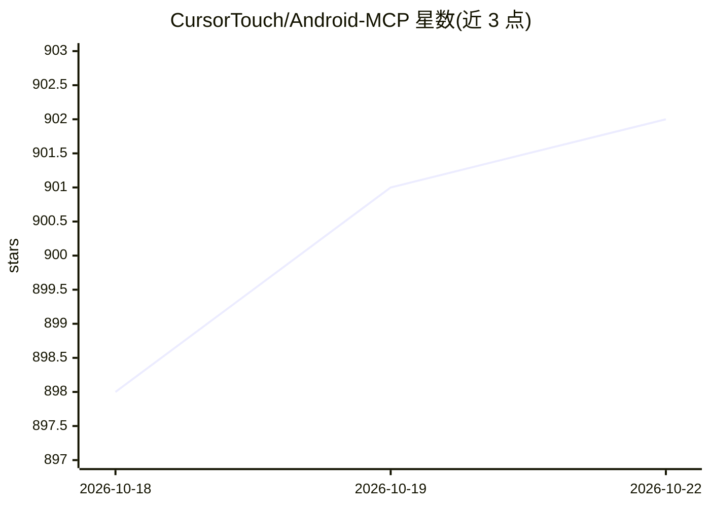

# CursorTouch/Android-MCP

⭐ 902 · Python · MIT · 推送 2026-10-21 · [GitHub](https://github.com/CursorTouch/Android-MCP) · 组织维护

**让 LLM agent 通过 MCP 直接操控 Android 设备的服务器**

以 MCP server 形式运行的 Python 工具，作为 AI agent 与 Android 设备之间的桥梁：通过 ADB 与 Android Accessibility API 提供点击、滑动、输入文本、读取视图层级、手势、按键、截屏、shell 命令等工具，供 LLM agent 执行应用导航、UI 交互与自动化 QA 测试，无需 CV 模型或 OCR 管线。支持任意 LLM/VLM，配置到 Claude Desktop 或 OpenCode 使用；要求 Python 3.13 与 adb，动作间典型延迟 2-4 秒，支持 USB/WiFi 连接与多设备选择。

## 筛选速览

| 维度 | 判定 | 备注 |
|---|---|---|
| AI 角色 | `ai-ecosystem` | LLM/agent 周边工具 |
| 许可风险 | `permissive` | MIT |
| 部署形态 | `None` |  |
| 模型依赖 | — | README 未给出锁定关系 |
| 硬件要求 | — | 无带数字的原话,不猜 |
| 安装摩擦 | `low` | 无编译、无系统依赖或容器化 |
| 成熟度 | — | 结构信号不足 |

## 能力要点

- 基于 ADB 与 Accessibility API 的原生 Android UI 交互工具集（点击/滑动/输入/截屏/shell）
- 模型无关：适配任意 LLM/VLM，无需微调 CV 模型或 OCR 管线
- USB/WiFi 设备连接与按 serial/环境变量的设备选择
- 截图量化选项（SCREENSHOT_QUANTIZED）以减少输入 token

## 适用场景

- 让 Claude 等 agent 用自然语言操控我的 Android 设备
- 自动化移动应用的 UI 操作与 QA 测试
- 在模拟器或测试机上运行 agent 驱动的自动化任务

## 场景标签

`GUI 自动化` · 领域:效率与自动化

## 证据(README 行号)

> L17: **Android-MCP** is a lightweight, open-source tool that bridge between AI agents and Android devices. Running as an
> L26: - **Bring Your Own LLM/VLM**

## 星数曲线

2026-10-18 898 → 2026-10-22 902（+4）

---
*卡片 v1 · prompt 1.4 · 生成 2026-10-21 · 置信度 high · 依据 README sha `177a85d1cac7` · [字段定义](../../DATASET.md)*
