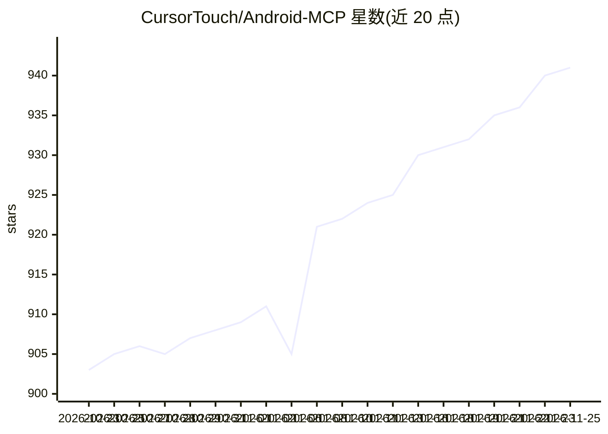

# CursorTouch/Android-MCP

⭐ 941 · Python · MIT · 推送 2026-11-22 · [GitHub](https://github.com/CursorTouch/Android-MCP) · 个人维护

**让 AI agent 通过 MCP 操作 Android 设备的 ADB 服务器**

一个 MCP Server，使 AI agent 借助 ADB 控制 Android 设备，设备端无需安装任何东西，仅依赖 adb。提供设备列表/连接选择（USB/Wi-Fi 自动切换）、屏幕快照（交互元素与标注截图）、点击/滑动/拖拽、按属性查找元素点击、输入文本与按键等工具；非 ASCII 输入可选安装 GPL-2.0 的 ADBKeyboard 应用。已知限制：忙屏（视频/计时器）时元素转储会放弃，Drag 需 Android 8+，清空输入框需 Android 12+。

## 筛选速览

| 维度 | 判定 | 备注 |
|---|---|---|
| AI 角色 | `ai-ecosystem` | LLM/agent 周边工具 |
| 许可风险 | `permissive` | MIT |
| 部署形态 | `desktop` | 安装包/桌面程序 |
| 模型依赖 | — | README 未给出锁定关系 |
| 硬件要求 | — | 无带数字的原话,不猜 |
| 安装摩擦 | `low` | 无编译、无系统依赖或容器化 |
| 成熟度 | — | 结构信号不足 |

## 能力要点

- 通过 MCP stdio 提供 12+ 个设备操作工具（快照、点击、输入、按键等）
- 支持 USB/Wi-Fi 连接选择与切换（adb tcpip/connect）
- 设备端零安装，仅依赖 adb；可选 ADBKeyboard 支持非 ASCII 输入
- 支持 --device/--connection/--wifi/--usb 及环境变量配置设备选择

## 适用场景

- 让 Claude 等 MCP 客户端代替我操作 Android 手机
- 通过 Wi-Fi 远程控制测试设备
- 对应用界面做基于元素标注的自动化交互

## 场景标签

`GUI 自动化` · 领域:效率与自动化

## 证据(README 行号)

> L3: An MCP server that lets an AI agent operate an Android device over ADB.
> L16: The server speaks MCP on stdio. In a client's config:

## 星数曲线

2026-10-23 903 → 2026-11-25 941（+38）

---
*卡片 v1 · prompt 1.4 · 生成 2026-11-24 · 置信度 high · 依据 README sha `404226445c6d` · [字段定义](../../DATASET.md)*
