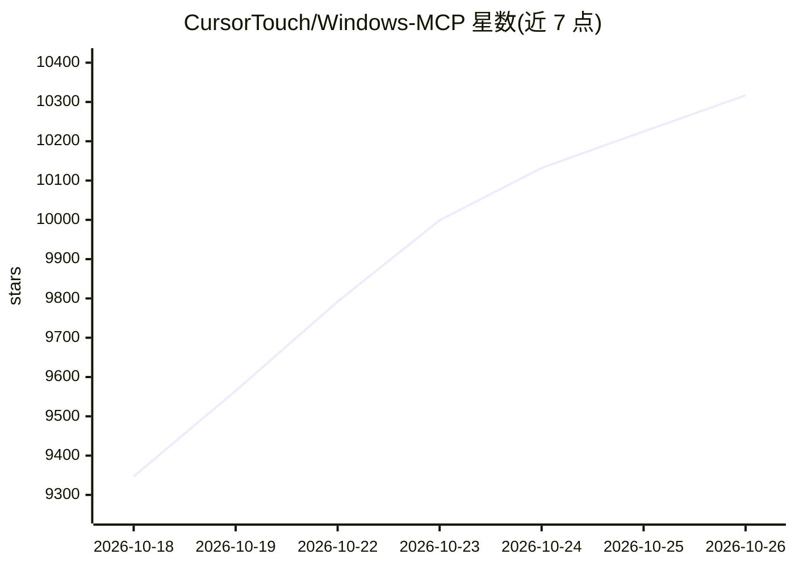

# CursorTouch/Windows-MCP

⭐ 10,317 · Python · MIT · 推送 2026-10-25 · [GitHub](https://github.com/CursorTouch/Windows-MCP) · 组织维护

**让 AI agent 通过 MCP 操控 Windows 桌面的 MCP 服务器**

以 MCP 服务器形式连接 LLM 与 Windows 操作系统，向 Claude Desktop、Perplexity Desktop、Gemini CLI、Qwen Code、Codex CLI、Claude Code 等客户端提供键盘/鼠标模拟、窗口与 UI 元素交互、应用控制、UI 状态捕获等工具，并含面向网页内容的 DOM 模式（支持 Chrome/Edge/Firefox）。不依赖视觉模型，任意 LLM 均可使用；动作间典型延迟 0.2-0.5 秒。要求 Windows 10/11 与 Python 3.14+，通过 PyPI/uvx 安装，支持 stdio/SSE/streamable-http 三种传输，远程访问可启用鉴权、IP 白名单与 TLS。

## 筛选速览

| 维度 | 判定 | 备注 |
|---|---|---|
| AI 角色 | `ai-ecosystem` | LLM/agent 周边工具 |
| 许可风险 | `permissive` | MIT |
| 部署形态 | `desktop` | 安装包/桌面程序 |
| 模型依赖 | — | README 未给出锁定关系 |
| 硬件要求 | — | 无带数字的原话,不猜 |
| 安装摩擦 | `low` | 无编译、无系统依赖或容器化 |
| 成熟度 | — | 结构信号不足 |

## 能力要点

- 提供键盘鼠标、窗口控制与 UI 状态捕获等 UI 自动化工具集
- DOM 模式过滤浏览器 UI，支持 Chrome/Edge/Firefox 网页自动化
- 不依赖视觉模型或微调模型，任意 LLM 可用
- 支持 stdio/SSE/streamable-http 传输，远程访问可配置鉴权、IP 白名单与 TLS

## 适用场景

- 让 Claude Desktop 等客户端直接操作本机 Windows 应用与文件
- 用自然语言驱动桌面 UI 自动化或 QA 测试
- 在 WSL 内的 Claude Code 通过桥接调用 Windows 侧 UI 自动化

## 场景标签

`GUI 自动化` `浏览器自动化` · 领域:效率与自动化

## 证据(README 行号)

> L22: **Windows-MCP** is a lightweight, open-source project that enables seamless integration between AI agents and the W
> L343: Windows-MCP runs directly on your Windows machine and exposes its tools to the connected MCP client.

## 星数曲线

2026-10-18 9,347 → 2026-10-26 10,317（+970）

---
*卡片 v1 · prompt 1.4 · 生成 2026-10-20 · 置信度 mid · 依据 README sha `387c74aeab53` · [字段定义](../../DATASET.md)*
