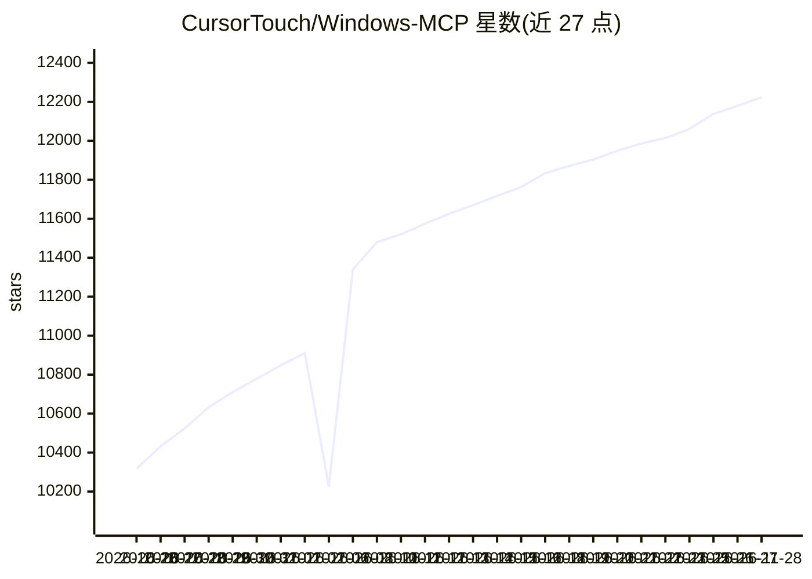

# CursorTouch/Windows-MCP

⭐ 12,224 · Python · MIT · 推送 2026-11-27 · [GitHub](https://github.com/CursorTouch/Windows-MCP) · 组织维护

**连接 AI Agent 与 Windows 系统的 MCP 服务器**

以 MCP 服务器形式连接 LLM/Agent 与 Windows 操作系统的开源项目：提供文件导航、应用控制、UI 交互、键鼠模拟、窗口/状态捕获、QA 测试等工具集，支持浏览器 DOM 模式自动化（Chrome/Edge/Firefox）。运行在 Windows 10/11 上，需 Python 3.14+，通过 uvx 从 PyPI 运行或源码运行，支持 stdio/SSE/HTTP 传输，可注册为登录后台任务。README 给出在 Claude Desktop、Perplexity Desktop、Gemini CLI、Qwen Code、Codex CLI、Claude Code 等客户端中的配置方法。

## 筛选速览

| 维度 | 判定 | 备注 |
|---|---|---|
| AI 角色 | `ai-ecosystem` | LLM/agent 周边工具 |
| 许可风险 | `permissive` | MIT |
| 部署形态 | `desktop` | 安装包/桌面程序 |
| 模型依赖 | — | README 未给出锁定关系 |
| 硬件要求 | — | 无带数字的原话,不猜 |
| 安装摩擦 | `low` | 无编译、无系统依赖或容器化 |
| 成熟度 | — | 结构信号不足 |

## 能力要点

- 提供文件导航、应用控制、UI 交互等 Windows 自动化工具集
- 支持任意 LLM，不依赖传统计算机视觉或特定微调模型
- 支持 stdio/SSE/Streamable HTTP 传输及登录自启动（计划任务）
- use_dom 模式过滤浏览器 UI，聚焦网页内容自动化

## 适用场景

- 让 Claude Desktop 等 MCP 客户端控制 Windows 应用与文件
- 用 AI agent 做 Windows UI 的 QA 测试
- 浏览器页面的 agent 自动化操作

## 场景标签

`GUI 自动化` `浏览器自动化` · 领域:效率与自动化

## 证据(README 行号)

> L22: **Windows-MCP** is a lightweight, open-source project that enables seamless integration between AI agents and the W
> L29: - Windows-MCP is now available on PyPI (thus supports `uvx windows-mcp`)
> L357: Windows-MCP runs directly on your Windows machine and exposes its tools to the connected MCP client.

## 星数曲线

2026-10-26 10,317 → 2026-11-28 12,224（+1,907）

---
*卡片 v1 · prompt 1.4 · 生成 2026-11-28 · 置信度 mid · 依据 README sha `cb12fea4995c` · [字段定义](../../DATASET.md)*
