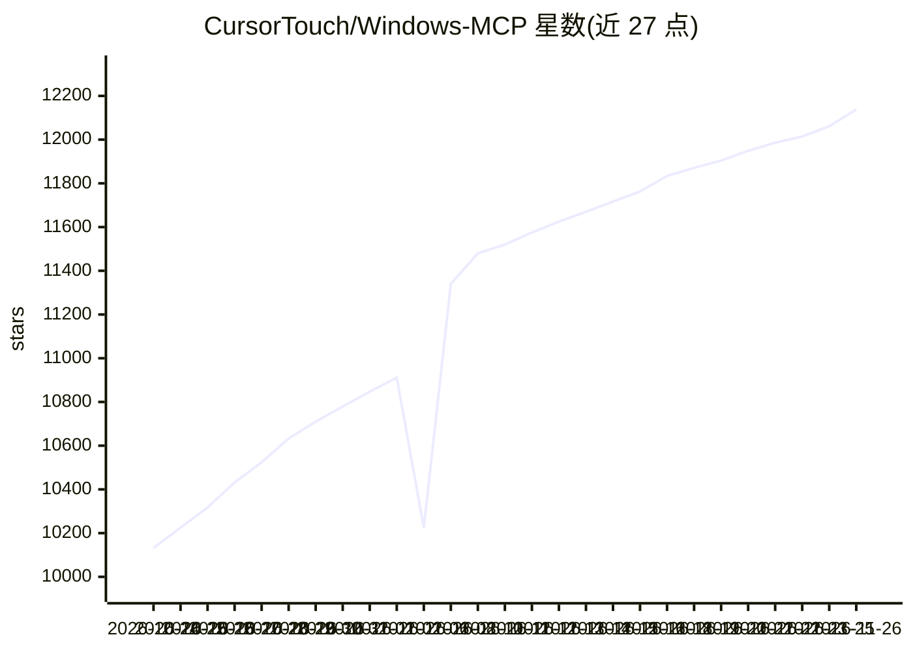

# CursorTouch/Windows-MCP

⭐ 12,138 · Python · MIT · 推送 2026-11-25 · [GitHub](https://github.com/CursorTouch/Windows-MCP) · 组织维护

**让 AI agent 操控 Windows 系统的 MCP 服务器**

以 MCP 服务器形式连接 LLM agent 与 Windows 操作系统，提供文件导航、应用控制、窗口/UI 交互、键盘鼠标模拟、QA 测试等工具集；不依赖传统计算机视觉技术或微调模型，可配合任意 LLM 使用（视觉可选）。支持 stdio/SSE/Streamable HTTP 三种传输方式，可注册为登录后台任务或网络访问。仅支持 Windows 10/11，要求 Python 3.14+ 与 UV 包管理器，MIT 许可。

## 筛选速览

| 维度 | 判定 | 备注 |
|---|---|---|
| AI 角色 | `ai-ecosystem` | LLM/agent 周边工具 |
| 许可风险 | `permissive` | MIT |
| 部署形态 | `desktop` | 安装包/桌面程序 |
| 模型依赖 | — | README 未给出锁定关系 |
| 硬件要求 | — | 无带数字的原话,不猜 |
| 安装摩擦 | `low` | 无编译、无系统依赖或容器化 |
| 成熟度 | — | 结构信号不足 |

## 能力要点

- 通过 MCP 协议向 Claude Desktop、Gemini CLI、Codex CLI 等客户端暴露 Windows 操控工具
- 不依赖传统 CV 或微调模型，可配合任意 LLM（视觉可选）
- DOM Mode 浏览器自动化，支持 Chrome/Edge/Firefox
- 操作延迟 0.2–0.5 秒，支持 stdio/SSE/HTTP 传输与远程访问认证

## 适用场景

- 让 Claude Desktop 等 MCP 客户端直接操作我的 Windows 应用和文件
- 用自然语言 agent 做 Windows UI 自动化与 QA 测试
- 在局域网内远程调用本机的 Windows 操控工具

## 场景标签

`浏览器自动化` `GUI 自动化` · 领域:效率与自动化

## 证据(README 行号)

> L22: **Windows-MCP** is a lightweight, open-source project that enables seamless integration between AI agents and the W
> L50: - **Use Any LLM (Vision Optional)**
> L83: uvx windows-mcp serve

## 星数曲线

2026-10-24 10,132 → 2026-11-26 12,138（+2,006）

---
*卡片 v1 · prompt 1.4 · 生成 2026-11-26 · 置信度 mid · 依据 README sha `770bbfc2724f` · [字段定义](../../DATASET.md)*
