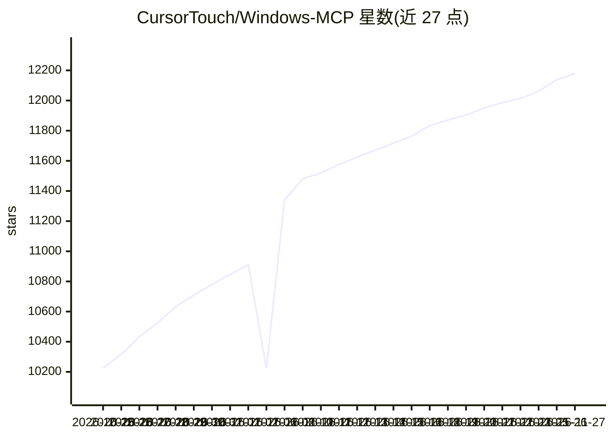

# CursorTouch/Windows-MCP

⭐ 12,179 · Python · MIT · 推送 2026-11-26 · [GitHub](https://github.com/CursorTouch/Windows-MCP) · 组织维护

**让 AI agent 操控 Windows 系统的 MCP 服务器**

轻量开源 MCP 服务器，在 LLM 与 Windows 操作系统之间架桥，暴露文件导航、应用控制、UI 交互、键盘鼠标模拟、窗口/UI 状态捕获等工具供 agent 调用。不依赖传统计算机视觉或微调模型，可配合任意 LLM（视觉可选）。支持 stdio/SSE/Streamable HTTP 传输，提供登录自启的计划任务安装方式，另有面向浏览器页面的 DOM 模式，支持 Chrome/Edge/Firefox。要求 Windows 10/11 与 Python 3.14+，MIT 许可。

## 筛选速览

| 维度 | 判定 | 备注 |
|---|---|---|
| AI 角色 | `ai-ecosystem` | LLM/agent 周边工具 |
| 许可风险 | `permissive` | MIT |
| 部署形态 | `desktop` | 安装包/桌面程序 |
| 模型依赖 | — | README 未给出锁定关系 |
| 硬件要求 | — | 无带数字的原话,不猜 |
| 安装摩擦 | `low` | 无编译、无系统依赖或容器化 |
| 成熟度 | — | 结构信号不足 |

## 能力要点

- 通过 MCP 协议向客户端暴露 Windows UI 自动化工具集（键盘、鼠标、窗口状态捕获）
- 支持任意 LLM，不依赖计算机视觉或专用模型
- 支持 stdio/SSE/Streamable HTTP 三种传输方式与登录自启
- DOM 模式专注网页内容自动化，支持 Chrome/Edge/Firefox

## 适用场景

- 让 Claude Desktop 等 MCP 客户端里的 agent 代为操作 Windows 应用与文件
- 用自然语言驱动的 agent 做桌面 UI 自动化测试
- 通过 DOM 模式让 agent 自动化浏览器网页操作

## 场景标签

`GUI 自动化` `浏览器自动化` · 领域:效率与自动化

## 证据(README 行号)

> L22: **Windows-MCP** is a lightweight, open-source project that enables seamless integration between AI agents and the W
> L68: ## 🛠️Installation
> L83: uvx windows-mcp serve

## 星数曲线

2026-10-25 10,225 → 2026-11-27 12,179（+1,954）

---
*卡片 v1 · prompt 1.4 · 生成 2026-11-27 · 置信度 mid · 依据 README sha `8aea20b5bfd7` · [字段定义](../../DATASET.md)*
