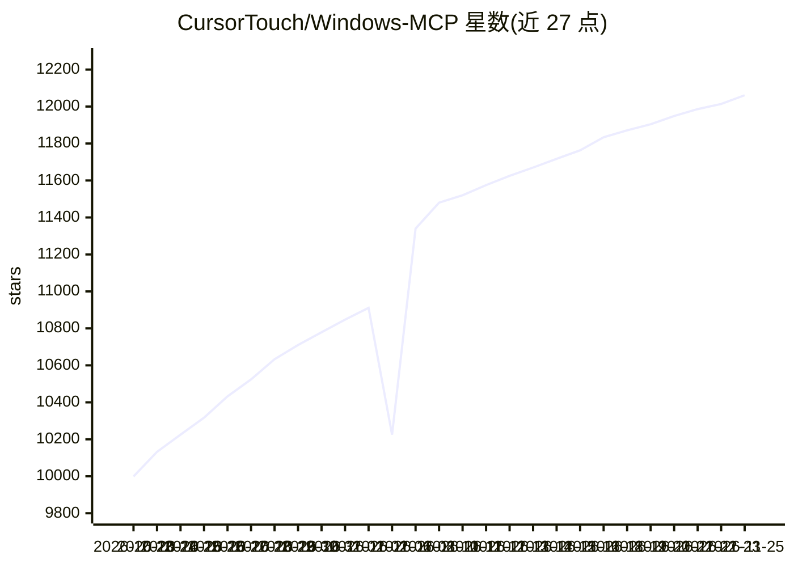

# CursorTouch/Windows-MCP

⭐ 12,061 · Python · MIT · 推送 2026-11-23 · [GitHub](https://github.com/CursorTouch/Windows-MCP) · 组织维护

**让 AI 代理操控 Windows 桌面的 MCP 服务器**

连接 AI 代理与 Windows 操作系统的 MCP 服务器，向 Claude Desktop、Perplexity Desktop、Gemini CLI、Qwen Code、Codex CLI、Claude Code 等客户端暴露文件导航、应用控制、UI 交互、键盘鼠标模拟、窗口/UI 状态捕获等工具。不依赖计算机视觉或特定微调模型，声明可配合任意 LLM 使用（视觉可选）。支持 stdio/SSE/Streamable HTTP 传输、登录时后台运行与远程访问认证。需 Windows 10/11、Python 3.14+ 与 uv。MIT 许可。

## 筛选速览

| 维度 | 判定 | 备注 |
|---|---|---|
| AI 角色 | `ai-ecosystem` | LLM/agent 周边工具 |
| 许可风险 | `permissive` | MIT |
| 部署形态 | `desktop` | 安装包/桌面程序 |
| 模型依赖 | — | README 未给出锁定关系 |
| 硬件要求 | — | 无带数字的原话,不猜 |
| 安装摩擦 | `low` | 无编译、无系统依赖或容器化 |
| 成熟度 | — | 结构信号不足 |

## 能力要点

- MCP 服务器形式向客户端暴露 Windows UI 自动化工具（键盘/鼠标/窗口状态捕获）
- 声明不依赖传统 CV 技术或微调模型，可配合任意 LLM
- 支持 stdio/SSE/Streamable HTTP 传输与登录时后台任务运行
- DOM 模式浏览器自动化，支持 Chrome/Edge/Firefox

## 适用场景

- 让 LLM 客户端通过工具自动操作 Windows 应用与文件
- 对 Windows 应用做 QA 自动化测试
- 从 Claude Code/WSL 等环境远程或本地驱动桌面任务

## 场景标签

`GUI 自动化` `浏览器自动化` · 领域:效率与自动化

## 证据(README 行号)

> L22: **Windows-MCP** is a lightweight, open-source project that enables seamless integration between AI agents and the W
> L68: ## 🛠️Installation
> L357: Windows-MCP runs directly on your Windows machine and exposes its tools to the connected MCP client.

## 星数曲线

2026-10-23 9,999 → 2026-11-25 12,061（+2,062）

---
*卡片 v1 · prompt 1.4 · 生成 2026-11-24 · 置信度 mid · 依据 README sha `08cc6792514a` · [字段定义](../../DATASET.md)*
