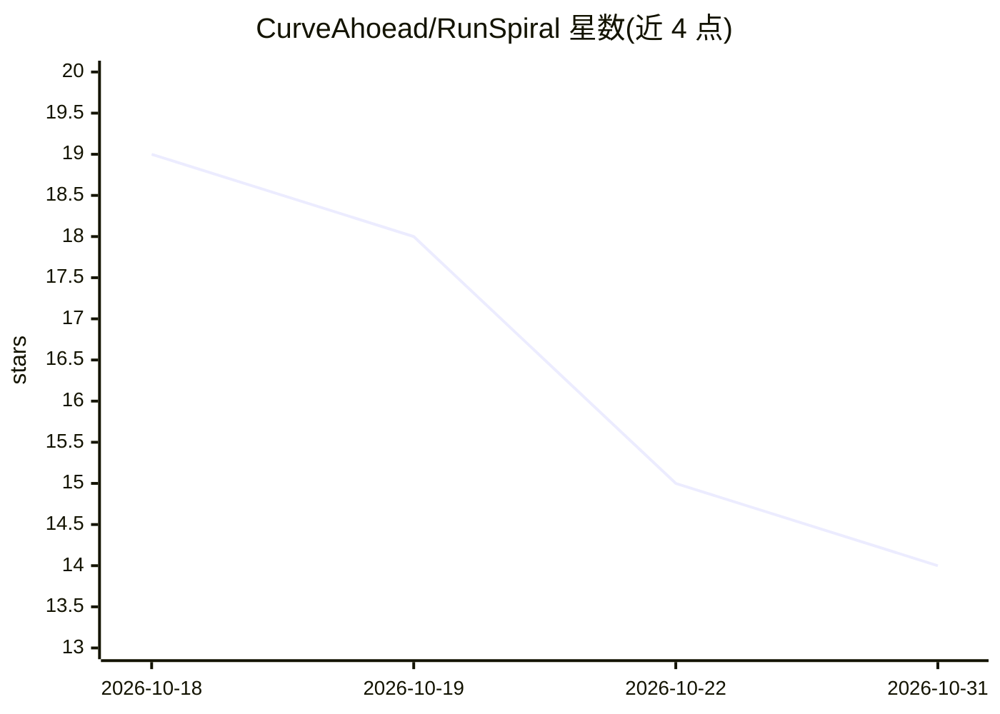

# CurveAhoead/RunSpiral

⭐ 14 · Python · MIT · 推送 2026-09-06 · [GitHub](https://github.com/CurveAhoead/RunSpiral) · 个人维护

**给开发者的 AI 运行可复现性分析器：评测重复运行的稳定性**

面向模型/agent/流水线的评测工具：读取同一任务多次运行的 JSONL/JSON 记录，按 task_id 分组后从三个维度打分——回答稳定性（众数答案占比+平均成对相似度）、路径一致性（最常见工具路径占比）、时延变异系数，加权合成 0-1 的可复现性总分并映射 A-F 等级，输出确定性报告可作为 CI 门禁（runspiral gate）。Python 包含 analyze/inspect/gate CLI；配套 Go 组件 spiral 提供大日志的 fold 预聚合与 FNV-1a 路径指纹，两者仅通过共享记录 schema 解耦协作。评分自身完全确定，不依赖 LLM 调用。

## 筛选速览

| 维度 | 判定 | 备注 |
|---|---|---|
| AI 角色 | `ai-ecosystem` | LLM/agent 周边工具 |
| 许可风险 | `permissive` | MIT |
| 部署形态 | `None` |  |
| 模型依赖 | — | README 未给出锁定关系 |
| 硬件要求 | — | 无带数字的原话,不猜 |
| 安装摩擦 | `low` | 无编译、无系统依赖或容器化 |
| 成熟度 | — | 结构信号不足 |

## 能力要点

- 回答稳定性/路径一致性/时延方差三轴打分，加权合成 A-F 复现等级
- runspiral gate 将总分转为 CI 通过/失败判定
- metrics 模块零依赖：token Jaccard、字符 bigram Dice、变异系数等
- Go 组件 spiral 做大规模日志 fold 预聚合与顺序无关路由指纹

## 适用场景

- 评测 agent 或 LLM 应用时量化重复运行的方差
- 把可复现性分数作为 CI 门禁，拦截不稳定回归
- 大日志先 fold 分片再全量打分

## 场景标签

`模型评测` · 领域:评测与运维

## 证据(README 行号)

> L7: RunSpiral turns a pile of repeated run records into a clear verdict: how
> L61: RunSpiral fits into the tail end of any evaluation or benchmarking loop. The
> L79: 4. **Gate.** `runspiral gate` turns the overall score into a CI pass/fail.

## 星数曲线

2026-10-18 19 → 2026-10-31 14（-5）

---
*卡片 v1 · prompt 1.4 · 生成 2026-10-31 · 置信度 high · 依据 README sha `a096b26f0efa` · [字段定义](../../DATASET.md)*
