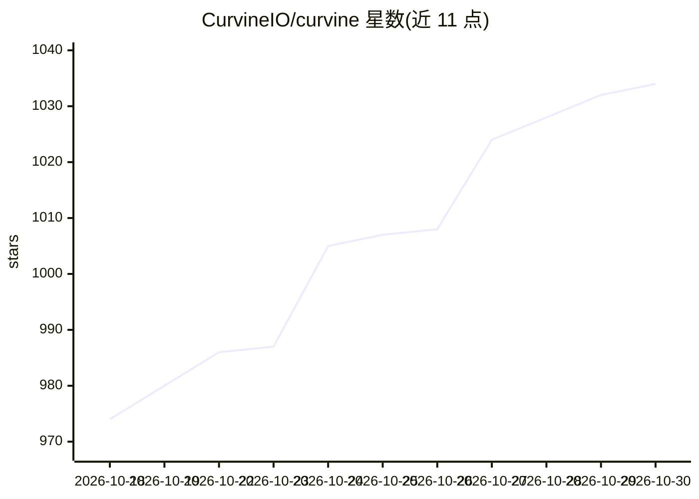

# CurvineIO/curvine

⭐ 1,034 · Rust · Apache-2.0 · 推送 2026-10-29 · [GitHub](https://github.com/CurvineIO/curvine) · [官网](https://curvineio.github.io) · 组织维护 · 中文 README

**面向 AI 训练与 Agent 平台的云对象存储高性能缓存文件系统**

Curvine 是用 Rust 编写的分布式缓存文件系统（CNCF Sandbox 项目），在云对象存储之上提供完整 POSIX 语义层，内置 Memory→SSD→HDD 多级分布式缓存，元数据由 Raft 复制的 Master 管理。访问途径包括 FUSE、S3 兼容网关、HDFS 适配器、Java/Python/Rust SDK 与 Kubernetes CSI 驱动。定位为 AI 训练加速与万级 Agent Pod 存储场景，支持 AWS S3/Azure/GCS/OSS 等多云后端；README 附有与 JuiceFS、Alluxio 的基准对比数据。采用 Apache 2.0 许可。

## 筛选速览

| 维度 | 判定 | 备注 |
|---|---|---|
| AI 角色 | `ai-ecosystem` | LLM/agent 周边工具 |
| 许可风险 | `permissive` | Apache-2.0 |
| 部署形态 | `None` |  |
| 模型依赖 | — | README 未给出锁定关系 |
| 硬件要求 | — | 无带数字的原话,不猜 |
| 安装摩擦 | `low` | 无编译、无系统依赖或容器化 |
| 成熟度 | — | 结构信号不足 |

## 能力要点

- 在多云对象存储上提供完整 POSIX 语义的分布式文件系统
- Memory→SSD→HDD 多级缓存与热点数据自动提升
- FUSE、S3 网关、HDFS 适配、多语言 SDK 与 Kubernetes CSI 多种接入方式
- Raft 复制元数据，元数据路径与底层 S3 对象路径 1:1 映射

## 适用场景

- 为万级有状态 Agent Pod 提供隔离的 POSIX 工作区
- 将训练数据集与 checkpoint 缓存到 GPU 节点近旁以缩短训练周期
- 跨多云对象存储建立统一缓存层
- 加速多区域 LLM 模型制品分发

## 场景标签

`模型训练` · 领域:训练与推理

## 证据(README 行号)

> L20: > **Curvine: AI-Native & Cloud-Native File System** — A high-performance POSIX file semantic layer built on top of 
> L40: Curvine is a high-performance distributed cache file system built in Rust. It layers a distributed POSIX file syste
> L55: - **AI-Native Positioning**: First-class support for AI training acceleration and AI Agent cloud-native storage as 

## 星数曲线

2026-10-18 974 → 2026-10-30 1,034（+60）

---
*卡片 v1 · prompt 1.4 · 生成 2026-10-21 · 置信度 high · 依据 README sha `01e9f70648a3` · [字段定义](../../DATASET.md)*
