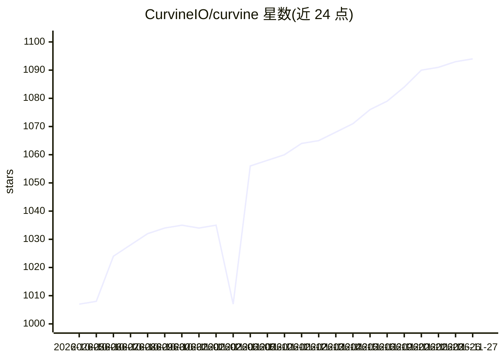

# CurvineIO/curvine

⭐ 1,094 · Rust · Apache-2.0 · 推送 2026-11-26 · [GitHub](https://github.com/CurvineIO/curvine) · [官网](https://curvineio.github.io) · 组织维护 · 中文 README

**面向 AI 训练/推理/Agent 的对象存储 POSIX 文件系统**

用 Rust 编写的分布式文件系统，在 S3 等对象存储之上提供完整 POSIX 语义与内存→SSD→HDD 多级分布式缓存。面向 AI 训练、推理与 Agent 平台场景，通过 FUSE、S3 网关、Hadoop API、Java/Python/Rust SDK 与 Kubernetes CSI 驱动接入；元数据经 Raft 复制，文件与对象路径 1:1 映射。CNCF Sandbox 项目，Apache 2.0 许可，提供 Docker 一键演示、Helm 部署与源码构建方式。

## 筛选速览

| 维度 | 判定 | 备注 |
|---|---|---|
| AI 角色 | `ai-ecosystem` | LLM/agent 周边工具 |
| 许可风险 | `permissive` | Apache-2.0 |
| 部署形态 | `library` | 以包/库形式分发 |
| 模型依赖 | — | README 未给出锁定关系 |
| 硬件要求 | — | 无带数字的原话,不猜 |
| 安装摩擦 | `low` | 无编译、无系统依赖或容器化 |
| 成熟度 | — | 结构信号不足 |

## 能力要点

- 对象存储之上的 POSIX 语义（FUSE 挂载通过 1,129 项 LTP 测试）
- 内存→SSD→HDD 多级缓存，热数据自动提升与淘汰
- Kubernetes CSI 驱动动态供给，单集群支持 50 亿文件
- 文件与对象路径 1:1 映射，数据可直接以普通对象读取

## 适用场景

- 为上万个有状态 Agent pod 提供毫秒级 POSIX 工作区
- 在 GPU 节点旁缓存数据集与 checkpoint 加速 LLM 训练
- 通过缓存跨区域分发模型权重
- 为存算分离的 OLAP 引擎缓存热数据

## 场景标签

 · 领域:AI 基础设施/分布式存储

## 证据(README 行号)

> L23:  The AI-native, cloud-native file system.
> L25:  Built in Rust for AI training, inference, and AI agent platforms.
> L128: - **Protocol layer.** Existing tools connect without code changes through POSIX (FUSE), an S3-compatible gateway, 

## 星数曲线

2026-10-25 1,007 → 2026-11-27 1,094（+87）

---
*卡片 v1 · prompt 1.4 · 生成 2026-11-24 · 置信度 high · 依据 README sha `b1e2e405e34b` · [字段定义](../../DATASET.md)*
