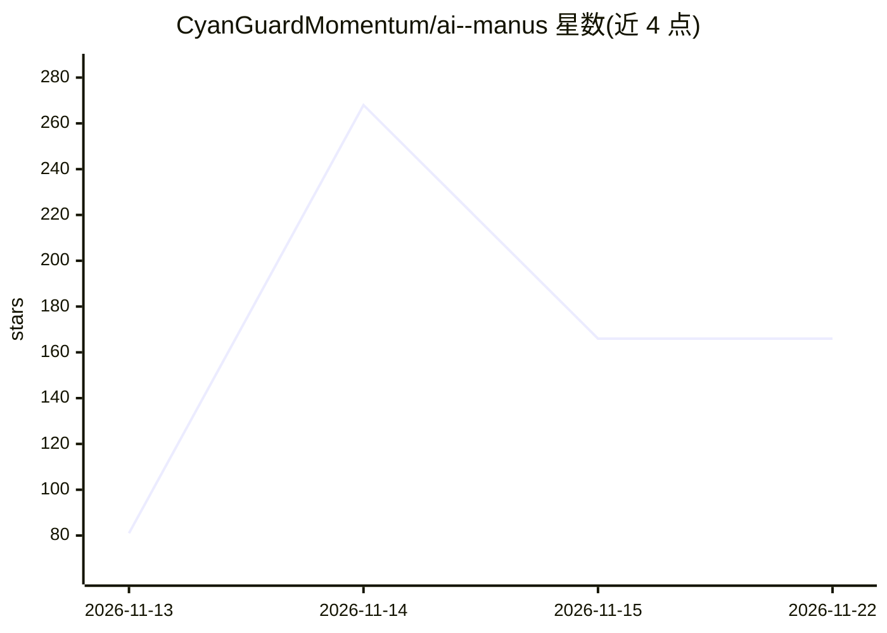

# CyanGuardMomentum/ai--manus

⭐ 166 · Apache-2.0 · 推送 2026-11-15 · [GitHub](https://github.com/CyanGuardMomentum/ai--manus) · 个人维护

**面向个人用户的自主 AI Agent：代写并执行代码、控制浏览器**

自述为通用自主 AI Agent，核心能力为代用户执行代码脚本与控制浏览器（导航网页、填表、收集信息），并承担多步骤日常任务自动化与后台个人助理职能。README 定位其为家庭、学习与轻量办公场景的助手，明确说明其非面向企业平台，无需用户具备开发背景。文档给出兼容性表（最低 4GB 内存、双核 CPU）与上手、测试、维护流程说明，但未提供任何具体安装命令、技术架构、模型接入方式或代码仓库内容。

## 筛选速览

| 维度 | 判定 | 备注 |
|---|---|---|
| AI 角色 | `ai-native` | 本体是模型或模型工具 |
| 许可风险 | `permissive` | Apache-2.0 |
| 部署形态 | `None` |  |
| 模型依赖 | — | README 未给出锁定关系 |
| 硬件要求 | — | 无带数字的原话,不猜 |
| 安装摩擦 | `low` | 无编译、无系统依赖或容器化 |
| 成熟度 | — | 结构信号不足 |

## 能力要点

- 自主执行代码与脚本以完成任务
- 浏览器控制：导航网页、填写表单、收集信息
- 代码与浏览器操作在同一任务流中衔接
- 跨会话记忆工作流模式

## 适用场景

- 让学生整理研究笔记、运行小型脚本
- 远程工作者从多页面收集数据并汇总
- 把重复性的网页检查、文件整理等小事委托给后台 agent

## 场景标签

`AI 助手` `浏览器自动化` `编码 Agent` · 领域:效率与自动化

## 证据(README 行号)

> L18: Manus is an autonomous AI agent designed to run code and control a browser on your behalf. Instead of acting like a
> L22: Manus is not a heavy studio suite or a complex enterprise platform. It is a focused helper built for home, study, a

## 星数曲线

2026-11-13 81 → 2026-11-22 166（+85）

---
*卡片 v1 · prompt 1.4 · 生成 2026-11-17 · 置信度 low · 依据 README sha `0f78ee3a5dd2` · [字段定义](../../DATASET.md)*
