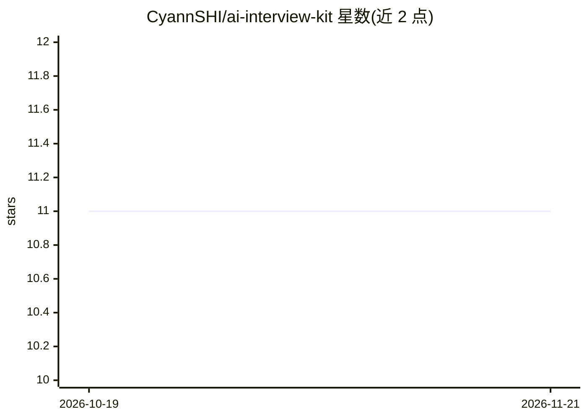

# CyannSHI/ai-interview-kit

⭐ 11 · HTML · MIT · 推送 2026-07-10 · [GitHub](https://github.com/CyannSHI/ai-interview-kit) · 个人维护 · 中文 README

**为 UX 研究者/PM 提供可大规模执行的用户访谈提示工程套件**

将用户研究方法论工程化为 AI 提示词的套件：6 种可插拔方法论（JTBD、旅程图、NPS、阶梯法等）经 SLOT 机制与通用框架、项目变量自动组装为生产级访谈提示，并提供 3 个技能（生成提示、准备输入变量、批量评估通话记录并输出 Excel 报告）。技能以纯自然语言编写，无 API 依赖，可放入主流 AI 编码工具的入口文件运行。MIT 许可，通过 git clone 获取。

## 筛选速览

| 维度 | 判定 | 备注 |
|---|---|---|
| AI 角色 | `ai-native` | 本体是模型或模型工具 |
| 许可风险 | `permissive` | MIT |
| 部署形态 | `None` |  |
| 模型依赖 | — | README 未给出锁定关系 |
| 硬件要求 | — | 无带数字的原话,不猜 |
| 安装摩擦 | `low` | 无编译、无系统依赖或容器化 |
| 成熟度 | — | 结构信号不足 |

## 能力要点

- 6 种可插拔研究方法论，通过 SLOT 机制以 3 个文件新增方法论
- 3 个 AI 控制模式参数化追问自由度（追问轮次上限、覆盖率等）
- 3 个技能：提示生成、输入变量结构化、通话记录批量评估出 Excel 报告
- 纯自然语言技能文件，无 API 依赖，兼容多种 AI 编码工具

## 适用场景

- 让 AI 按专业方法论代做大规模用户电话访谈
- 非研究背景的 PM/创始人生成专业的访谈提示词
- 批量评估通话记录、定位 bad case 并迭代提示词

## 场景标签

`提示工程` `科研工具` · 领域:Agent 开发

## 证据(README 行号)

> L44: > **The idea:** engineer research methodologies into AI prompts. Non-experts get professional interview quality. Ex
> L71:  Universal framework (how to ask) &ensp;+&ensp; Pluggable methodology (what to ask) &ensp;+&ensp; Project variables
> L159: All skills are written in **plain natural language** — zero API dependencies, auto-compatible with major AI coding

## 星数曲线

2026-10-19 11 → 2026-11-21 11（+0）

---
*卡片 v1 · prompt 1.4 · 生成 2026-11-19 · 置信度 high · 依据 README sha `a660cca5cff9` · [字段定义](../../DATASET.md)*
