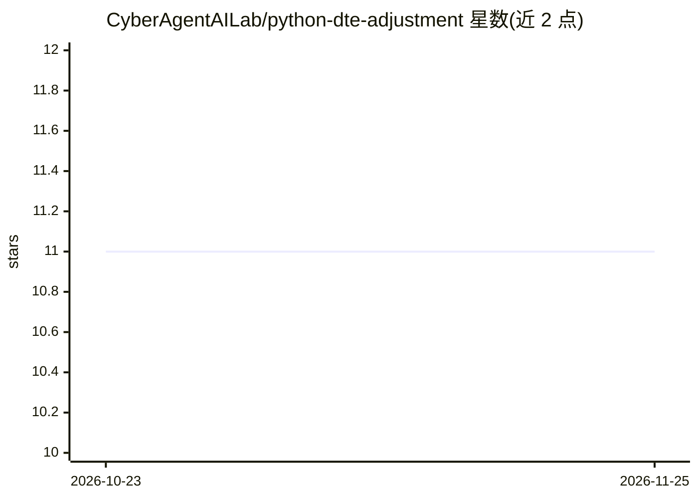

# CyberAgentAILab/python-dte-adjustment

⭐ 11 · Jupyter Notebook · MIT · 推送 2026-11-05 · [GitHub](https://github.com/CyberAgentAILab/python-dte-adjustment) · 组织维护

**估计分布处理效应的 Python 库：服务因果推断研究者**

dte_adj 是一个用于估计分布处理效应（distributional treatment effects）的 Python 包，提供回归调整 API 以估计精确的分布函数及配套工具。方法实现自 ICML'24、ICML'25、NeurIPS'25 等论文，覆盖简单随机化、协变量自适应随机化、多任务学习与不完全依从场景，并给出 BibTeX 引用格式。安装支持 PyPI 与源码两种途径，采用 MIT 许可。

## 筛选速览

| 维度 | 判定 | 备注 |
|---|---|---|
| AI 角色 | `ai-native` | 本体是模型或模型工具 |
| 许可风险 | `permissive` | MIT |
| 部署形态 | `library` | 以包/库形式分发 |
| 模型依赖 | — | README 未给出锁定关系 |
| 硬件要求 | — | 无带数字的原话,不猜 |
| 安装摩擦 | `low` | 无编译、无系统依赖或容器化 |
| 成熟度 | — | 结构信号不足 |

## 能力要点

- 回归调整估计精确分布函数的 API 与工具集
- 实现 ICML/NeurIPS 论文方法，覆盖四种随机化场景
- 提供 PyPI 与源码安装、BibTeX 引用与文档

## 适用场景

- 在随机对照实验中估计分布处理效应
- 按论文方法复现分布因果推断的估计结果
- 需要方差缩减或协变量自适应设计的效应估计

## 场景标签

`科研工具` · 领域:学习与行业

## 证据(README 行号)

> L3: `dte_adj` is a Python package for estimating distribution treatment effects. It provides APIs for conducting regress
> L25: This package implements methods from the following research papers:

## 星数曲线

2026-10-23 11 → 2026-11-25 11（+0）

---
*卡片 v1 · prompt 1.4 · 生成 2026-11-19 · 置信度 high · 依据 README sha `43b8a298e98e` · [字段定义](../../DATASET.md)*
