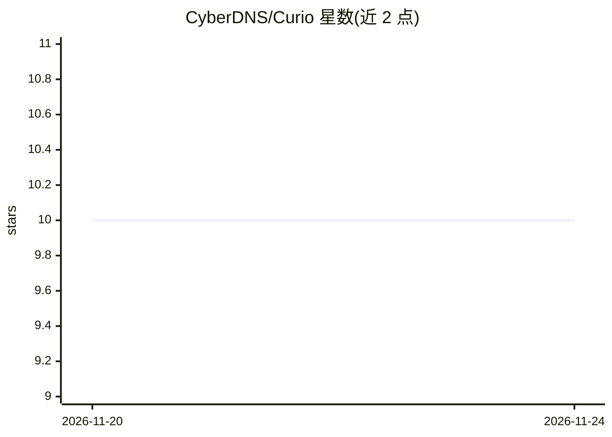

# CyberDNS/Curio

⭐ 10 · Python · MIT · 推送 2025-11-29 · [GitHub](https://github.com/CyberDNS/Curio) · 个人维护

**自托管 AI 个性化 RSS 聚合器，生成报纸式每日新闻**

自托管新闻聚合应用：读取用户添加的 RSS 源，调用 OpenAI API 对文章做筛选、相关性打分、去重、标题改写与摘要生成，按用户配置的兴趣输出报纸版式的每日刊物。提供分类组织、收藏、未读追踪、抓取频率调度等功能。通过 Docker/Unraid 部署，使用 PostgreSQL 存储数据，AI 功能必须配置 OpenAI API Key 并产生按量费用。MIT 许可，单用户模式可经 DEV_MODE 开启。

## 筛选速览

| 维度 | 判定 | 备注 |
|---|---|---|
| AI 角色 | `ai-native` | 本体是模型或模型工具 |
| 许可风险 | `permissive` | MIT |
| 部署形态 | `self-host` | docker 或自建部署 |
| 模型依赖 | — | README 未给出锁定关系 |
| 硬件要求 | — | 无带数字的原话,不猜 |
| 安装摩擦 | `low` | 无编译、无系统依赖或容器化 |
| 成熟度 | — | 结构信号不足 |

## 能力要点

- AI 依据用户兴趣做文章筛选、相关性打分与去重
- AI 生成标题改写与摘要，输出报纸版式每日刊物
- 支持无限 RSS 源、分类组织、收藏与自动已读
- 通过 Docker Compose 或 Unraid 模板自托管部署

## 适用场景

- 把多个 RSS 源整合成每天一份个性化的报纸式阅读页
- 按兴趣主题（科技/科学/商业）组织订阅源并让 AI 筛选重要文章
- 在家庭服务器（如 Unraid）上自托管新闻聚合服务

## 场景标签

 · 领域:资讯聚合/内容消费

## 证据(README 行号)

> L13: Curio is a self-hosted news aggregator that brings back the joy of reading a morning newspaper. It collects article
> L28: - **Smart article selection** - AI picks the most relevant articles for you
> L66: - **OpenAI API Key** - For AI features (Get one here)

## 星数曲线

2026-11-20 10 → 2026-11-24 10（+0）

---
*卡片 v1 · prompt 1.4 · 生成 2026-11-20 · 置信度 high · 依据 README sha `f51a7ee6ce42` · [字段定义](../../DATASET.md)*
