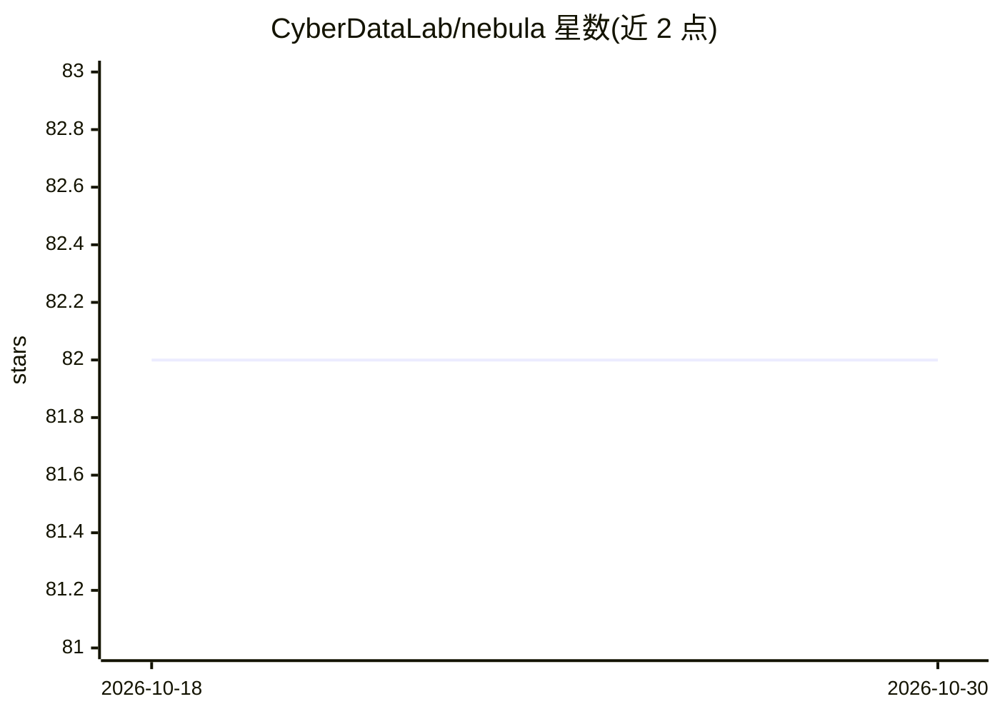

# CyberDataLab/nebula

⭐ 82 · Python · AGPL-3.0 · 推送 2026-06-29 · [GitHub](https://github.com/CyberDataLab/nebula) · [官网](https://nebula-dfl.com) · 组织维护

**支持中心化与去中心化联邦学习的训练平台**

原名 Fedstellar，由穆尔西亚大学、armasuisse 与苏黎世大学合作开发的联邦学习平台，用于在物理与虚拟化设备上开发、部署和管理联邦应用。架构含 Frontend、Controller、Core 三个模块；支持无中心服务器的去中心化训练、星型/环型/网状拓扑、设备端训练共享模型更新以保护隐私，并提供压缩、网络故障容忍、对抗攻击防护、差分隐私（Opacus）与实时监控。采用 GNU AGPLv3 许可，另提供商业专有许可的企业版。

## 筛选速览

| 维度 | 判定 | 备注 |
|---|---|---|
| AI 角色 | `ai-ecosystem` | LLM/agent 周边工具 |
| 许可风险 | `viral` | AGPL-3.0 |
| 部署形态 | `None` |  |
| 模型依赖 | — | README 未给出锁定关系 |
| 硬件要求 | — | 无带数字的原话,不猜 |
| 安装摩擦 | `low` | 无编译、无系统依赖或容器化 |
| 成熟度 | — | 结构信号不足 |

## 能力要点

- 去中心化联邦学习训练，无需中央服务器
- 支持星型/环型/网状多种网络拓扑
- 集成差分隐私（Opacus）、对抗攻击防护（ART）与可信度指标
- 基于 PyTorch Lightning 的训练循环与 FastAPI RESTful API

## 适用场景

- 在医疗、工业 4.0、车载等场景跨设备训练联邦模型
- 数据不出设备的前提下协同训练机器学习模型
- 研究去中心化联邦学习中的安全与可信机制

## 场景标签

`模型训练` `MLOps` · 领域:训练与推理

## 证据(README 行号)

> L17: **NEBULA** (previously known as Fedstellar[^1]) is a cutting-edge platform designed to facilitate the training of f
> L41: - **Decentralized**: Train models without a central server, leveraging decentralized federated learning.

## 星数曲线

2026-10-18 82 → 2026-10-30 82（+0）

---
*卡片 v1 · prompt 1.4 · 生成 2026-10-24 · 置信度 high · 依据 README sha `ad2374e1b4a5` · [字段定义](../../DATASET.md)*
