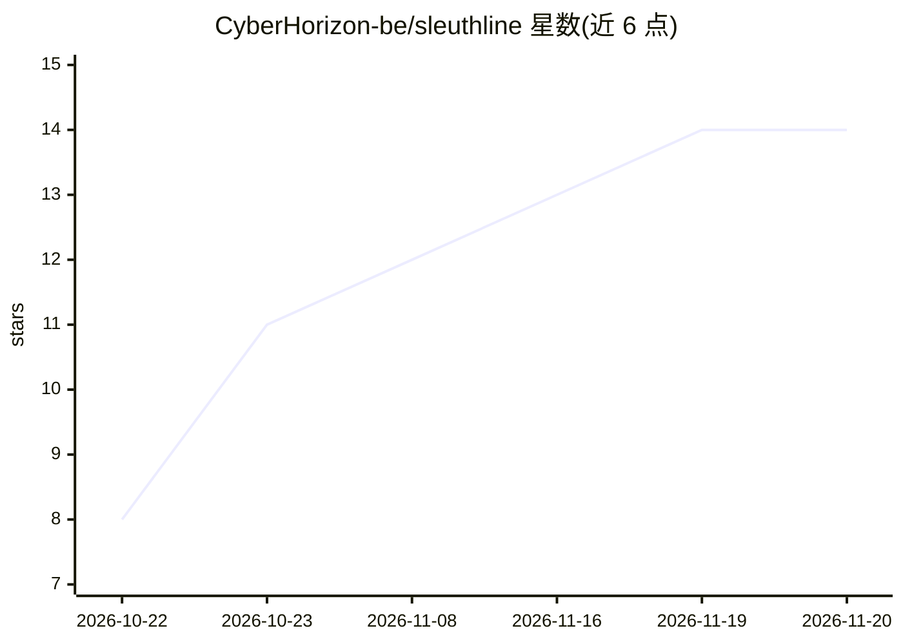

# CyberHorizon-be/sleuthline

⭐ 14 · Python · MIT · 推送 2026-11-18 · [GitHub](https://github.com/CyberHorizon-be/sleuthline) · [官网](https://cyberhorizon.be/) · 组织维护

**Windows DFIR 流水线：从取证采集到有证据支撑的应急响应报告**

面向隔离分析虚拟机的 Windows 数字取证与应急响应（DFIR）流水线，分 inventory、parse、normalize、analyze 四个命令运行：用 EZTools、Hayabusa、Volatility 3、Suricata 等公认取证工具解析 KAPE 磁盘采集、内存镜像与网络抓包，将全部输出归一化到单一 DuckDB 数据库并构建 UTC 时间线，再由 LLM agent 按 playbook 逐步调查并生成 Word 报告，每条结论引用数据库中可验证记录。要求 Windows 10/11 或 Server 2019+ 64 位专用 VM、管理员 PowerShell，通过 PowerShell 脚本一键安装全部工具；README 强调报告须经合格分析师审查。

## 筛选速览

| 维度 | 判定 | 备注 |
|---|---|---|
| AI 角色 | `ai-enhanced` | 去掉 AI 部分产品仍成立 |
| 许可风险 | `permissive` | MIT |
| 部署形态 | `desktop` | 安装包/桌面程序 |
| 模型依赖 | local-ok | 支持本地模型 |
| 硬件要求 | — | 无带数字的原话,不猜 |
| 安装摩擦 | `medium` | 含编译或系统依赖之一 |
| 成熟度 | — | 结构信号不足 |

## 能力要点

- 四个命令的流水线：inventory→parse→normalize→analyze，产出带证据引用的 Word 报告
- 磁盘、内存、网络三类来源独立计数，时间线行与结论可追溯到具体记录
- 支持 Claude（默认）、OpenAI 兼容 API 或本地模型（Ollama、LM Studio、vLLM），数据不出 VM
- 工具版本锁定于 tools-lock.json，记录流水线 git commit 以保证可复现

## 适用场景

- 从 KAPE triage 采集、内存镜像和网络抓包重建入侵过程
- 内存镜像或 pcap 单一来源的离线取证分析
- 在隔离 VM 内用本地模型做不让数据外流的威胁狩猎
- 生成每条结论带数据库记录引用的技术报告供分析师复核

## 场景标签

`网络安全` · 领域:学习与行业

## 证据(README 行号)

> L5: Sleuthline is a Windows DFIR pipeline for an isolated analysis VM. It takes a KAPE triage collection (e.g. `!SANS_Tr
> L17: - **Any model.** Claude (default), any OpenAI-compatible API, or a local model (Ollama, LM Studio, vLLM) so that no
> L28: > Sleuthline assists an analyst; it is not an automated expert. The report must be reviewed and validated by a qual

## 星数曲线

2026-10-22 8 → 2026-11-20 14（+6）

---
*卡片 v1 · prompt 1.4 · 生成 2026-11-18 · 置信度 mid · 依据 README sha `dd735191dd6a` · [字段定义](../../DATASET.md)*
