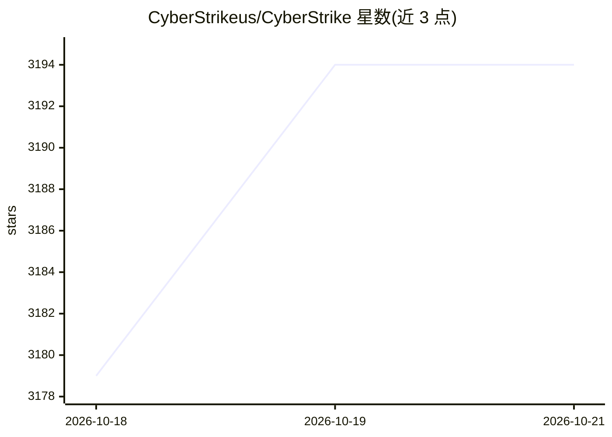

# CyberStrikeus/CyberStrike

⭐ 3,194 · TypeScript · AGPL-3.0 · 推送 2026-10-14 · [GitHub](https://github.com/CyberStrikeus/CyberStrike) · [官网](https://cyberstrike.io) · 组织维护

**终端 AI 红队 agent：接入 LLM 订阅自动做渗透测试**

开源命令行安全 harness，接入用户已有的 LLM 订阅或 API（150+ 提供商、5,300+ 模型，支持 Ollama/LM Studio 离线运行），将通用模型转化为自动化渗透测试 agent：13+ 领域 agent、7,600+ 签名技能文件、8 个代理子测试器（3 门确认协议）、内置 Chromium 浏览器 HackBrowser 抓取并分析流量，另有 Bolt 远程工具执行与 Web UI。面向渗透测试人员与安全研究者，按 TUI 首次运行配置提供商与 API key。

## 筛选速览

| 维度 | 判定 | 备注 |
|---|---|---|
| AI 角色 | `ai-native` | 本体是模型或模型工具 |
| 许可风险 | `viral` | AGPL-3.0 |
| 部署形态 | `library` | 以包/库形式分发 |
| 模型依赖 | local-ok | 支持本地模型 |
| 硬件要求 | — | 无带数字的原话,不猜 |
| 安装摩擦 | `low` | 无编译、无系统依赖或容器化 |
| 成熟度 | — | 结构信号不足 |

## 能力要点

- 13+ 专用安全 agent，覆盖 Web/移动/云/内网，遵循 OWASP WSTG、MASTG、CIS 等框架
- 8 个代理子测试器采用 3 门确认协议（基线/攻击/对比），自动抑制重复发现
- 7,600+ Ed25519 签名安全技能文件，按需懒加载注入 agent 提示
- 支持 Ollama/LM Studio 完全离线运行，数据不出本机

## 适用场景

- 授权渗透测试中自动化侦察、漏洞发现与利用
- Bug bounty 中对 Web 应用跑 OWASP Top 10 测试
- 用本地模型在气隙环境离线执行安全测试
- 多账号浏览时自动发现角色权限差异（IDOR/越权）

## 场景标签

`网络安全` · 领域:学习与行业

## 证据(README 行号)

> L29:  Automated penetration testing from your terminal — plug in your Claude, GPT, or any LLM subscription
> L30:  and turn it into an autonomous red team agent with 13+ specialized agents, 7,600+ security skills, and 120+ OWASP 
> L58: That's it. CyberStrike launches a TUI in your terminal, asks for your LLM provider and API key on first run, and yo

## 星数曲线

2026-10-18 3,179 → 2026-10-21 3,194（+15）

---
*卡片 v1 · prompt 1.4 · 生成 2026-10-20 · 置信度 high · 依据 README sha `122d813bfc8a` · [字段定义](../../DATASET.md)*
