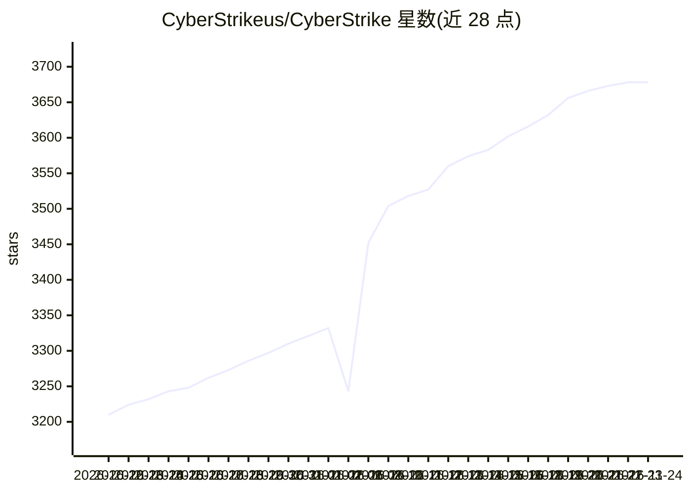

# CyberStrikeus/CyberStrike

⭐ 3,678 · TypeScript · AGPL-3.0 · 推送 2026-11-22 · [GitHub](https://github.com/CyberStrikeus/CyberStrike) · [官网](https://cyberstrike.io) · 组织维护 · 中文 README

**开源 agentic AI 渗透测试框架：从终端自动执行完整渗透测试**

终端内运行的 agentic AI 渗透测试框架：接入用户已有的 LLM 订阅后，执行侦察、漏洞发现、利用与报告生成，报告含严重度、PoC 请求、CWE 映射与修复建议。内置 7,600+ 方法论文档的技能库、多个领域 agent（含 OWASP WSTG 编排器与 12 个子 agent）、内置测试浏览器 HackBrowser、HTTP 流量引擎 Vortex，以及通过 MCP 服务器扩展的安全工具集，并提供 Web UI 与远程服务器编排（Bolt）。首运行选择 LLM provider。

## 筛选速览

| 维度 | 判定 | 备注 |
|---|---|---|
| AI 角色 | `ai-native` | 本体是模型或模型工具 |
| 许可风险 | `viral` | AGPL-3.0 |
| 部署形态 | `library` | 以包/库形式分发 |
| 模型依赖 | local-ok | 支持本地模型 |
| 硬件要求 | — | 无带数字的原话,不猜 |
| 安装摩擦 | `low` | 无编译、无系统依赖或容器化 |
| 成熟度 | — | 结构信号不足 |

## 能力要点

- 从终端运行侦察→漏洞发现→利用→报告的完整流程，报告含 CWE 映射与修复建议
- 3-gate 确认协议（baseline→attack→response diff）丢弃推测性结果
- 7,600+ 方法论文档技能库与 4 种可切换 agent
- HackBrowser 内置浏览器、Vortex HTTP 流量引擎与 5 个安全 MCP 服务器扩展

## 适用场景

- 渗透测试中自动化侦察与初始测试环节
- 漏洞赏金项目中保持一致的方法论与更广覆盖面
- 安全团队执行结构化 OWASP 评估并生成合规可读报告
- 以自定义 agent、技能和 MCP 服务器扩展测试平台

## 场景标签

`网络安全` · 领域:学习与行业

## 证据(README 行号)

> L27:  Open-source AI agent that runs complete penetration tests.
> L72: CyberStrike injects offensive security methodology — OWASP testing procedures, vulnerability patterns, attack chain

## 星数曲线

2026-10-22 3,210 → 2026-11-24 3,678（+468）

---
*卡片 v1 · prompt 1.4 · 生成 2026-11-23 · 置信度 high · 依据 README sha `77a9efaa2ce8` · [字段定义](../../DATASET.md)*
