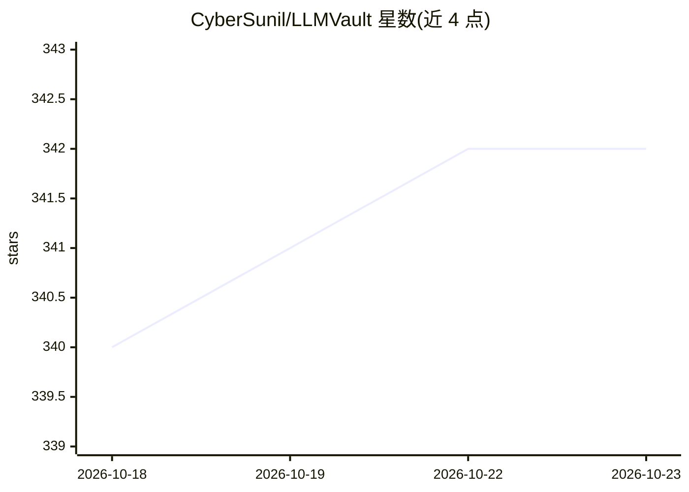

# CyberSunil/LLMVault

⭐ 342 · Python · MIT · 推送 2026-10-20 · [GitHub](https://github.com/CyberSunil/LLMVault) · 个人维护

**OWASP LLM Top 10 攻防训练靶场：25 个 CTF 实验室+真实本地模型对抗**

自托管的安全教育平台，覆盖 OWASP LLM Top 10 (2025)：Play Mode 提供 25 个按 Core/Advanced/Expert 分层的脚本化 CTF 实验室（提示注入、数据投毒、Agent 利用、模型提取等），逐级解锁，flag 可复现；Live Mode 连接本地 Ollama 真实模型做无剧本对抗，支持 OpenAI 兼容端点。每题配攻防两侧讲解。Flask 实现，pip 或 Docker 运行，无需数据库与 API key；Expert 层内容加密，需作者手动发放密钥。仅限授权的自托管教育用途。

## 筛选速览

| 维度 | 判定 | 备注 |
|---|---|---|
| AI 角色 | `ai-knowledge` | 知识聚合/清单类 |
| 许可风险 | `permissive` | MIT |
| 部署形态 | `self-host` | docker 或自建部署 |
| 模型依赖 | local-ok | 支持本地模型 |
| 硬件要求 | — | 无带数字的原话,不猜 |
| 安装摩擦 | `low` | 无编译、无系统依赖或容器化 |
| 成熟度 | — | 结构信号不足 |

## 能力要点

- Play Mode 25 个脚本化实验室（10 Core/10 Advanced/5 Expert），逐级解锁、flag 复现
- Live Mode 连接本地 Ollama 真实模型，secret 每次会话新生成
- 每个实验室配 OWASP 类别参考面板与解题后的防御讲解
- 全离线运行，无 API key、无数据库（进度存 JSON 文件）

## 适用场景

- 安全学习者动手练习 OWASP LLM Top 10 攻击与防御
- 团队/个人在本地搭建 AI 安全 CTF 训练场
- 对真实本地模型做无剧本的提示注入对抗练习

## 场景标签

`网络安全` · 领域:学习与行业

## 证据(README 行号)

> L29: A deliberately-vulnerable, CTF-style **training range for the OWASP Top 10 for LLM Applications (2025)** — WebGoat 
> L33: **Play Mode** is the scored range. **25 labs across three tiers:** ten core one-per-category labs; ten **advanced, 
> L37: Every lab pairs the **attack** with a **defense**: solve it, then read what would have stopped you.

## 星数曲线

2026-10-18 340 → 2026-10-23 342（+2）

---
*卡片 v1 · prompt 1.4 · 生成 2026-10-21 · 置信度 high · 依据 README sha `0e224e2b0e0d` · [字段定义](../../DATASET.md)*
