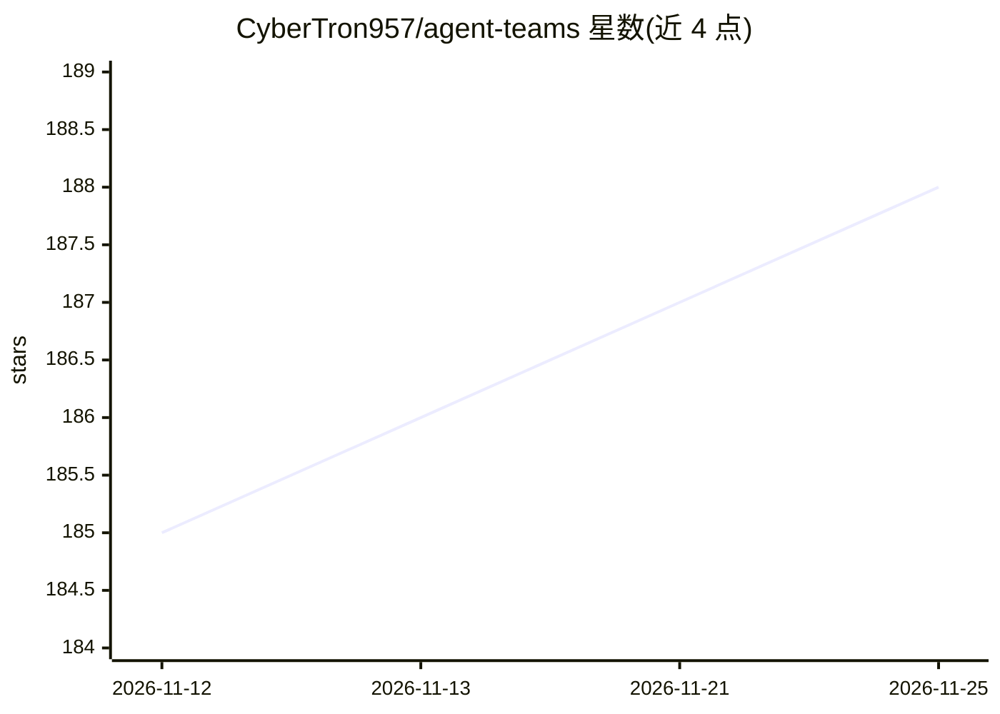

# CyberTron957/agent-teams

⭐ 188 · Python · MIT · 推送 2026-10-12 · [GitHub](https://github.com/CyberTron957/agent-teams) · 个人维护

**自托管多 AI Agent 团队编排系统，含调度、预算与看板**

基于 Hermes agent 的多智能体编排层：将多个 agent 组成有角色分工的团队，7×24 小时自主运行，提供监督 agent、循环/停滞自检、按团队每日预算自动暂停、人类审批收件箱（支持 CAPTCHA/2FA 浏览器接管）、cron 定时任务、上下文自动压缩与 SQLite 任务队列重启恢复，以及实时仪表盘。支持 40+ LLM 提供商。自部署于本机或 VPS，需 Python 3.11+ 与 Chromium。

## 筛选速览

| 维度 | 判定 | 备注 |
|---|---|---|
| AI 角色 | `ai-ecosystem` | LLM/agent 周边工具 |
| 许可风险 | `permissive` | MIT |
| 部署形态 | `self-host` | docker 或自建部署 |
| 模型依赖 | local-ok | 支持本地模型 |
| 硬件要求 | — | 无带数字的原话,不猜 |
| 安装摩擦 | `low` | 无编译、无系统依赖或容器化 |
| 成熟度 | — | 结构信号不足 |

## 能力要点

- 多 agent 团队 24/7 自主运行，监督 agent 检测循环与停滞
- 按团队每日预算控制成本，超限自动暂停
- 人类收件箱 + 浏览器接管处理凭据/CAPTCHA/2FA
- SQLite 任务队列在重启后恢复进行中的任务
- 内置 AI 团队构建器 Architect 访谈式生成团队

## 适用场景

- 让营销/销售/客服等多个 agent 团队全天候自动执行任务
- 控制多 agent 长期运行的成本并审计花费
- 在关键决策点人工介入审批 agent 的请求

## 场景标签

`多智能体` · 领域:Agent 开发

## 证据(README 行号)

> L154: |**Not an agent framework.**|We don't tell you how to build agents. Hermes is the agent; Agent Teams is the orches
> L156: |**Not cloud-hosted.**|Self-hosted on your hardware. Your API keys, your data, your infrastructure.|

## 星数曲线

2026-11-12 185 → 2026-11-25 188（+3）

---
*卡片 v1 · prompt 1.4 · 生成 2026-11-17 · 置信度 mid · 依据 README sha `b7336e414dbd` · [字段定义](../../DATASET.md)*
