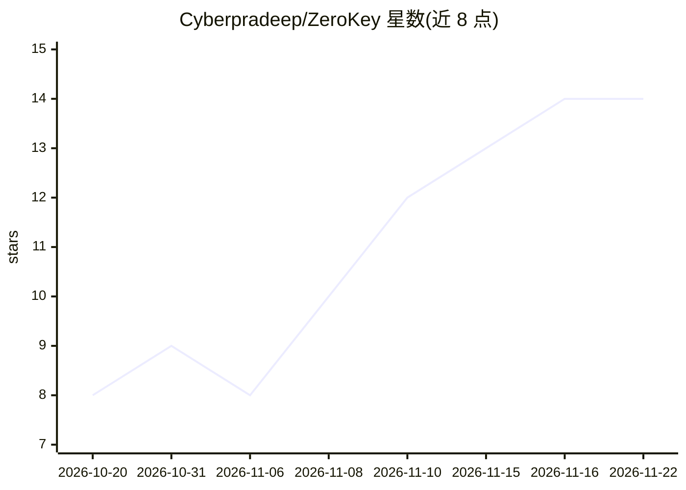

# Cyberpradeep/ZeroKey

⭐ 14 · Python · 推送 2026-09-18 · [GitHub](https://github.com/Cyberpradeep/ZeroKey) · 个人维护

**把 ChatGPT 网页订阅转成本地 OpenAI 兼容 API 的桥接工具**

在本地运行一个 OpenAI 兼容 API 服务（127.0.0.1:8088/v1），底层用 Playwright 驱动 Chromium 操作用户的 ChatGPT 网页会话，把发来的请求转为页面操作并返回标准化响应。支持 system prompt 持久化、结构化 tool_calls、Think 推理模式、图片/PDF 输入，数据全部留在本地、无按 token 计费。需一次性登录保存会话，配合 LangChain/AutoGen/CrewAI 等 agent 框架或 IDE 助手使用。

## 筛选速览

| 维度 | 判定 | 备注 |
|---|---|---|
| AI 角色 | `ai-ecosystem` | LLM/agent 周边工具 |
| 许可风险 | `none` | — |
| 部署形态 | `library` | 以包/库形式分发 |
| 模型依赖 | — | README 未给出锁定关系 |
| 硬件要求 | — | 无带数字的原话,不猜 |
| 安装摩擦 | `low` | 无编译、无系统依赖或容器化 |
| 成熟度 | — | 结构信号不足 |

## 能力要点

- 将 ChatGPT 网页会话桥接为 OpenAI 兼容 API（/v1 端点）
- 支持结构化 tool_calls 与 system prompt 持久化
- 通过请求参数动态启用 Think 推理模式，支持图片/PDF 附加
- Chromium 反后台节流标志，窗口最小化不中断生成

## 适用场景

- 让 LangChain/CrewAI/AutoGen agent 零 token 成本跑多轮循环
- 把 Cursor/Continue.dev 等 IDE 助手指向本地端点
- 批量文档摘要与数据提取流水线

## 场景标签

`浏览器自动化` `模型网关` · 领域:Agent 开发

## 证据(README 行号)

> L10: > ZeroKey turns your personal ChatGPT web subscription into a **100% free, unlimited, local OpenAI-compatible API k
> L19: **ZeroKey bridges this gap.** It runs a persistent, automated Playwright Chromium engine on your machine. When your

## 星数曲线

2026-10-20 8 → 2026-11-22 14（+6）

---
*卡片 v1 · prompt 1.4 · 生成 2026-11-18 · 置信度 high · 依据 README sha `8a847cf3b508` · [字段定义](../../DATASET.md)*
