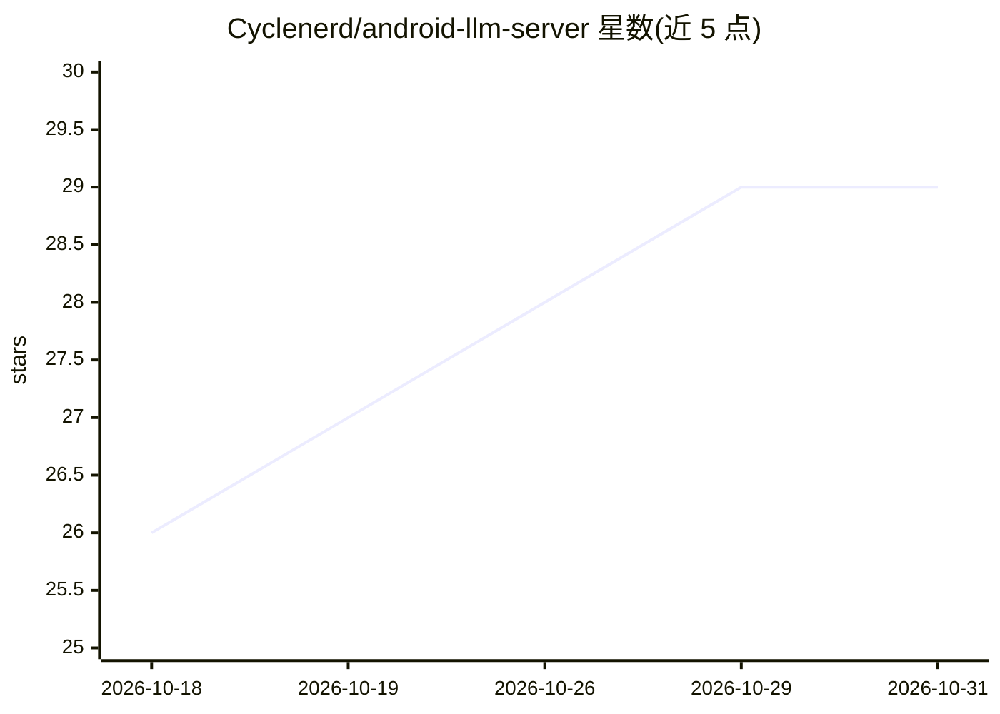

# Cyclenerd/android-llm-server

⭐ 29 · Kotlin · Apache-2.0 · 推送 2026-10-26 · [GitHub](https://github.com/Cyclenerd/android-llm-server) · 个人维护

**把 Android 手机变成本地 LLM 服务器的应用**

Android 应用，基于 Google LiteRT 推理引擎在手机 GPU 上本地运行 Gemma 4 E2B/E4B 模型，通过 Ktor 提供 OpenAI 兼容的 /v1/chat/completions API，供局域网内任意设备调用。面向希望复用旧旗舰手机做推理硬件、替代桌面 GPU 或云订阅的用户。要求 Android 16+、4GB+ RAM（推荐 8GB）、每模型 3-5GB 存储；以 APK 发布（不上架 Google Play），限制包括固定采样参数、无认证、仅绑定内网 IP。

## 筛选速览

| 维度 | 判定 | 备注 |
|---|---|---|
| AI 角色 | `ai-ecosystem` | LLM/agent 周边工具 |
| 许可风险 | `permissive` | Apache-2.0 |
| 部署形态 | `None` |  |
| 模型依赖 | — | README 未给出锁定关系 |
| 硬件要求 | — | 无带数字的原话,不猜 |
| 安装摩擦 | `low` | 无编译、无系统依赖或容器化 |
| 成熟度 | — | 结构信号不足 |

## 能力要点

- 在 Android 手机 GPU 上本地运行 Gemma 4 E2B/E4B
- 提供 OpenAI 兼容 API（/v1/chat/completions，支持流式）
- 仅绑定内网私有 IP，不可从公网访问
- 提供 ADB 命令用于远程/自动化管理

## 适用场景

- 把旧旗舰手机改作 24/7 本地 LLM 推理服务器
- 在局域网内为其他设备提供 OpenAI 兼容接口
- 不依赖云订阅、数据不出本地网络地使用 LLM

## 场景标签

`推理引擎` · 领域:训练与推理

## 证据(README 行号)

> L3: **High-performance, private AI on the edge.** Run world-class models like Google DeepMind's Gemma 4 locally on your 
> L117: **Endpoint:** `http://<device-ip>:8080/v1/chat/completions`
> L119: **Compatible with:** OpenAI Python SDK, LangChain, any OpenAI-compatible client

## 星数曲线

2026-10-18 26 → 2026-10-31 29（+3）

---
*卡片 v1 · prompt 1.4 · 生成 2026-10-26 · 置信度 high · 依据 README sha `52623b3e6f60` · [字段定义](../../DATASET.md)*
