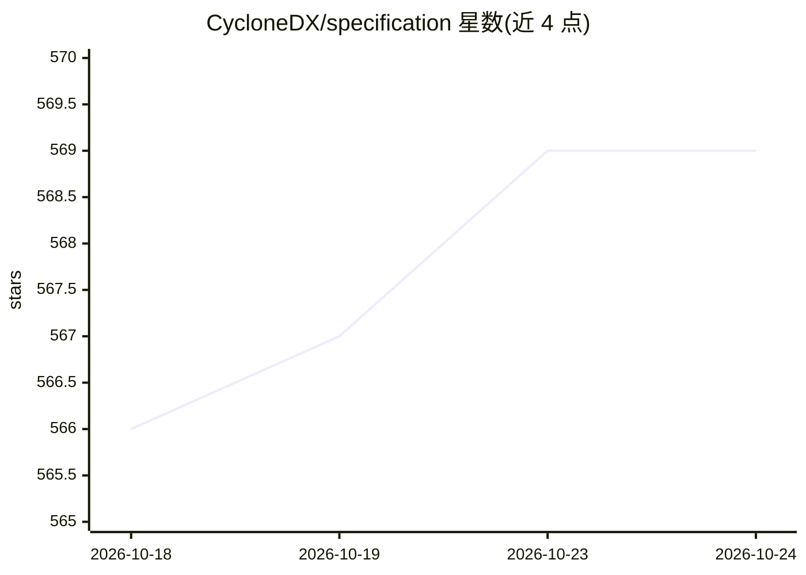

# CycloneDX/specification

⭐ 569 · XSLT · Apache-2.0 · 推送 2026-10-24 · [GitHub](https://github.com/CycloneDX/specification) · [官网](https://cyclonedx.org/) · 组织维护

**供应链物料清单（BOM）标准规范仓库（ECMA-424）**

OWASP CycloneDX 规范的官方仓库：维护全栈 BOM 标准 ECMA-424 及其 JSON/XML/ProtoBuf 模式文件，覆盖 SBOM、SaaSBOM、HBOM、机器学习 BOM（ML-BOM）、密码学 BOM、VDR/VEX 等十余种清单类型与漏洞披露格式。供工具厂商与供应链安全实践者实现合规的 BOM 交换；模式以 Apache 2.0 发布，标准本身采用免版税专利政策。仓库不含可运行程序，提供用例示例与媒体类型注册信息。

## 筛选速览

| 维度 | 判定 | 备注 |
|---|---|---|
| AI 角色 | `ai-ecosystem` | LLM/agent 周边工具 |
| 许可风险 | `permissive` | Apache-2.0 |
| 部署形态 | `None` |  |
| 模型依赖 | — | README 未给出锁定关系 |
| 硬件要求 | — | 无带数字的原话,不猜 |
| 安装摩擦 | `low` | 无编译、无系统依赖或容器化 |
| 成熟度 | — | 结构信号不足 |

## 能力要点

- Ecma 国际标准 ECMA-424 的官方模式文件（JSON/XML/ProtoBuf）
- 支持 SBOM、ML-BOM、CBOM、VDR、VEX 等十余种清单与披露格式
- IANA 注册的官方媒体类型（application/vnd.cyclonedx+json/xml）
- 约定 BOM 文件名与 glob 模式（bom.json、*.cdx.json 等）

## 适用场景

- 开发 BOM 生成/解析工具时实现与 CycloneDX 标准的兼容
- 以 ML-BOM 描述机器学习模型组件的供应链构成
- 查阅各版本规范的发布历史与官方解释

## 场景标签

 · 领域:软件供应链安全/标准规范

## 证据(README 行号)

> L25: * Machine Learning Bill of Materials (ML-BOM)
> L15: OWASP CycloneDX is a full-stack Bill of Materials (BOM) standard that provides advanced supply chain capabilities f

## 星数曲线

2026-10-18 566 → 2026-10-24 569（+3）

---
*卡片 v1 · prompt 1.4 · 生成 2026-10-21 · 置信度 mid · 依据 README sha `33efd40eca17` · [字段定义](../../DATASET.md)*
