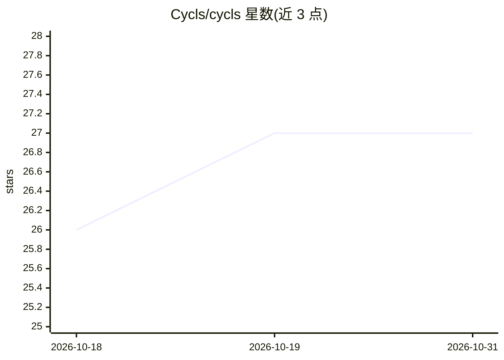

# Cycls/cycls

⭐ 27 · Python · 推送 2026-10-28 · [GitHub](https://github.com/Cycls/cycls) · [官网](https://cycls.com) · 组织维护

**Python SDK：用可组合原语构建并一条命令部署 AI agent**

面向 Python 开发者的 AI agent 开发与部署 SDK。以四个可组合原语（Image/Web/LLM/Volume）加三个装饰器定义 agent，`cycls deploy` 一条命令完成 Docker 容器化部署，自动生成聊天界面、用户登录、每用户文件与会话存储、OpenAI 兼容 API 端点及沙箱化工具循环。LLM 适配层统一 Anthropic 原生 API 与 OpenAI 兼容端点，支持工具调用、流式组件、OAuth 连接器与 MCP。状态持久化依赖挂载的 Volume，云部署需 API key（cloud.cycls.com）。

## 筛选速览

| 维度 | 判定 | 备注 |
|---|---|---|
| AI 角色 | `ai-ecosystem` | LLM/agent 周边工具 |
| 许可风险 | `none` | — |
| 部署形态 | `self-host` | docker 或自建部署 |
| 模型依赖 | locked-api |  |
| 硬件要求 | — | 无带数字的原话,不猜 |
| 安装摩擦 | `low` | 无编译、无系统依赖或容器化 |
| 成熟度 | — | 结构信号不足 |

## 能力要点

- Agent/App/Function 层级装饰器，单文件定义、单命令部署
- 统一多 provider LLM 适配层（Anthropic 原生 + OpenAI 兼容端点）
- 部署自带聊天 UI、登录、每用户文件与会话、OpenAI 兼容 API
- Bash 工具运行于 bubblewrap 沙箱，支持 MCP 与 OAuth 连接器

## 适用场景

- 快速把一个 Python agent 部署为带 UI 和 API 的线上服务
- 统一适配多家 LLM provider 并统一工具调用与流式输出
- 为团队构建带工作区、计费与用量分析的 agent 应用

## 场景标签

`Agent 框架` · 领域:Agent 开发

## 证据(README 行号)

> L19: The deep-stack AI SDK for Python. Every layer of an AI agent (runtime, interface, intelligence, state) as a composa
> L39: cycls deploy my_agent.py   # live at https://my-agent.cycls.ai
> L97: One adapter covers Anthropic natively and every OpenAI-compatible endpoint through `provider/model` strings and a b

## 星数曲线

2026-10-18 26 → 2026-10-31 27（+1）

---
*卡片 v1 · prompt 1.4 · 生成 2026-10-26 · 置信度 mid · 依据 README sha `bc71228cf9b2` · [字段定义](../../DATASET.md)*
