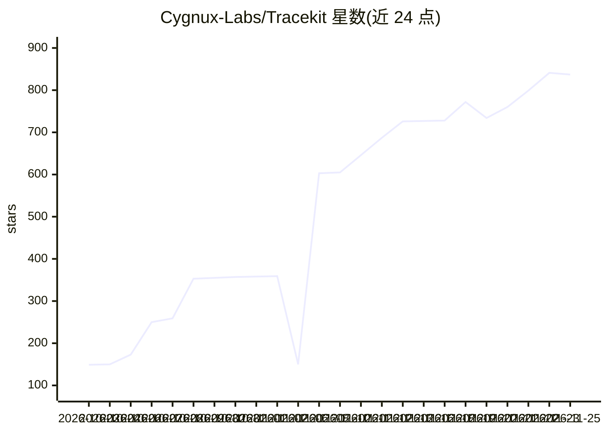

# Cygnux-Labs/Tracekit

⭐ 837 · Python · MIT · 推送 2026-11-24 · [GitHub](https://github.com/Cygnux-Labs/Tracekit) · [官网](https://cygnuxlabs.com/tracekit) · 组织维护

**AI agent 工具调用的事前管控与可离线验证的签名审计记录**

Tracekit 嵌入 agent 的 tool-call 路径：在每次调用执行前做 allow/deny/人工审批判定，并将调用、决策与结果签名写入 agent 无法触碰的 signer 所持有的哈希链日志，结构类似 Certificate Transparency。每次运行可导出为 .tkb 文件，验证器用 Python/TypeScript/Go 实现，可离线核验（含浏览器页面）。提供 tracekit.instrument() 三行接入、20+ 编码 agent 的 hooks 接线，Python 3.9–3.13，MIT 许可。

## 筛选速览

| 维度 | 判定 | 备注 |
|---|---|---|
| AI 角色 | `ai-ecosystem` | LLM/agent 周边工具 |
| 许可风险 | `permissive` | MIT |
| 部署形态 | `self-host` | docker 或自建部署 |
| 模型依赖 | — | README 未给出锁定关系 |
| 硬件要求 | — | 无带数字的原话,不猜 |
| 安装摩擦 | `low` | 无编译、无系统依赖或容器化 |
| 成熟度 | — | 结构信号不足 |

## 能力要点

- 每次工具调用执行前的策略判定与人工审批（审批绑定精确参数且一次性）
- 签名追加式日志 + 独立 witness 共签，防篡改可离线验证
- tracekit audit 只读扫描本地 Claude Code 等编码 agent 会话
- Python/TypeScript 双 SDK，MIT 许可，全部自托管运行

## 适用场景

- 把 agent 上生产前拦截危险调用（删库、curl|sh、读凭证、force-push）
- 向企业客户提交每次 agent 运行的可自行验证的运行记录
- 安全团队为 agent 推行建立统一管控点与事件取证
- 审计人员按 EU AI Act / ISO 42001 映射核验 AI 运行记录

## 场景标签

`LLM 可观测性` `网络安全` · 领域:评测与运维

## 证据(README 行号)

> L5: **Tracekit checks each tool call your agent makes before it runs, and risky calls wait for a person to approve them.
> L36: Tracekit sits in the tool-call path, the way a flight recorder sits in a plane:
> L130: `tracekit.instrument()` starts a dev signer (or reuses the running one) and gates and records every tool and model

## 星数曲线

2026-10-23 149 → 2026-11-25 837（+688）

---
*卡片 v1 · prompt 1.4 · 生成 2026-11-25 · 置信度 mid · 依据 README sha `38102c602fcb` · [字段定义](../../DATASET.md)*
