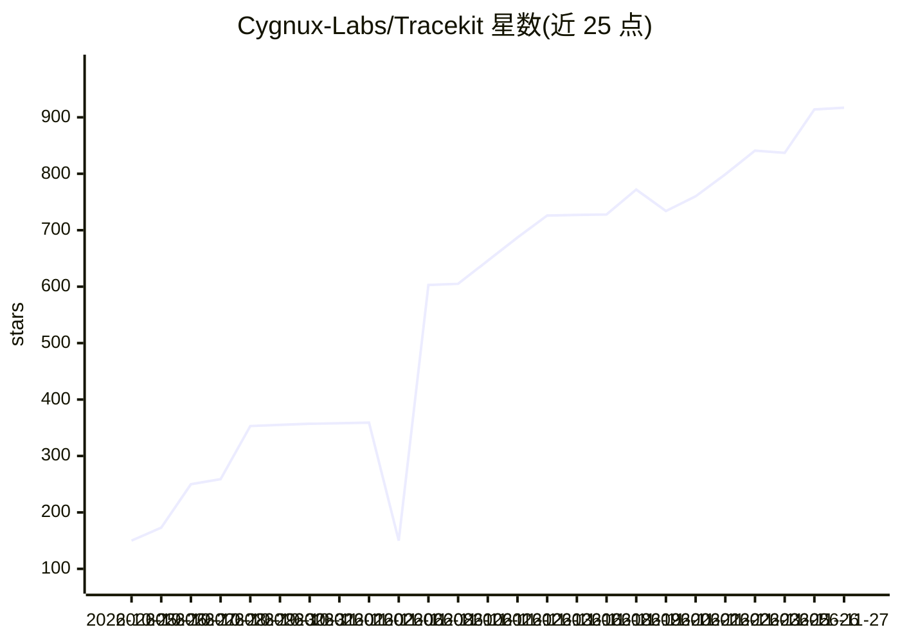

# Cygnux-Labs/Tracekit

⭐ 917 · Python · MIT · 推送 2026-11-26 · [GitHub](https://github.com/Cygnux-Labs/Tracekit) · [官网](https://cygnuxlabs.com/tracekit) · 组织维护

**给 AI agent 的防篡改审计记录器：逐次审批工具调用并可离线验证**

Tracekit 以飞行记录仪的方式嵌入 agent 的工具调用路径：每次调用前按策略判定允许/拒绝/转人工审批，审批与具体参数一次性绑定；所有调用、决策与结果由 agent 无法触及的独立 signer 进程签入哈希链，形成防篡改日志。每次运行可导出为 .tkb 文件，任何人在浏览器中即可离线验证，篡改会定位到具体事件。声称采用类 Certificate Transparency 的见证人共签机制，提供 Python/TypeScript/Go 验证器与合规框架映射。以 MIT 许可发布，pip/npm 安装。

## 筛选速览

| 维度 | 判定 | 备注 |
|---|---|---|
| AI 角色 | `ai-ecosystem` | LLM/agent 周边工具 |
| 许可风险 | `permissive` | MIT |
| 部署形态 | `self-host` | docker 或自建部署 |
| 模型依赖 | — | README 未给出锁定关系 |
| 硬件要求 | — | 无带数字的原话,不猜 |
| 安装摩擦 | `low` | 无编译、无系统依赖或容器化 |
| 成熟度 | — | 结构信号不足 |

## 能力要点

- 工具调用前策略门控：allow/deny/hold for person，审批绑定确切参数
- 独立 signer 进程签入哈希链的 append-only 防篡改日志
- .tkb 导出文件支持浏览器离线验证，篡改定位到事件
- 声明适配 42 个 agent 与框架（Claude Code、LangChain/LangGraph、MCP 等）

## 适用场景

- 编码 agent 自动运行后回看它实际改动过什么
- 把 agent 接入生产数据库/邮件/支付前拦截危险调用
- 向企业客户或审计方出示可自行验证的运行记录
- 安全团队为多框架 agent 设立统一管控点

## 场景标签

`网络安全` · 领域:学习与行业

## 证据(README 行号)

> L5: **Tracekit checks each tool call your agent makes before it runs, and risky calls wait for a person to approve them.
> L36: Tracekit sits in the tool-call path, the way a flight recorder sits in a plane:
> L105: |**An engineer shipping an agent to production** (support, ops, data, finance)|*"It works in the demo. I can't let
> L130: `tracekit.instrument()` starts a dev signer (or reuses the running one) and gates and records every tool and model

## 星数曲线

2026-10-25 150 → 2026-11-27 917（+767）

---
*卡片 v1 · prompt 1.4 · 生成 2026-11-27 · 置信度 mid · 依据 README sha `a66820779e71` · [字段定义](../../DATASET.md)*
