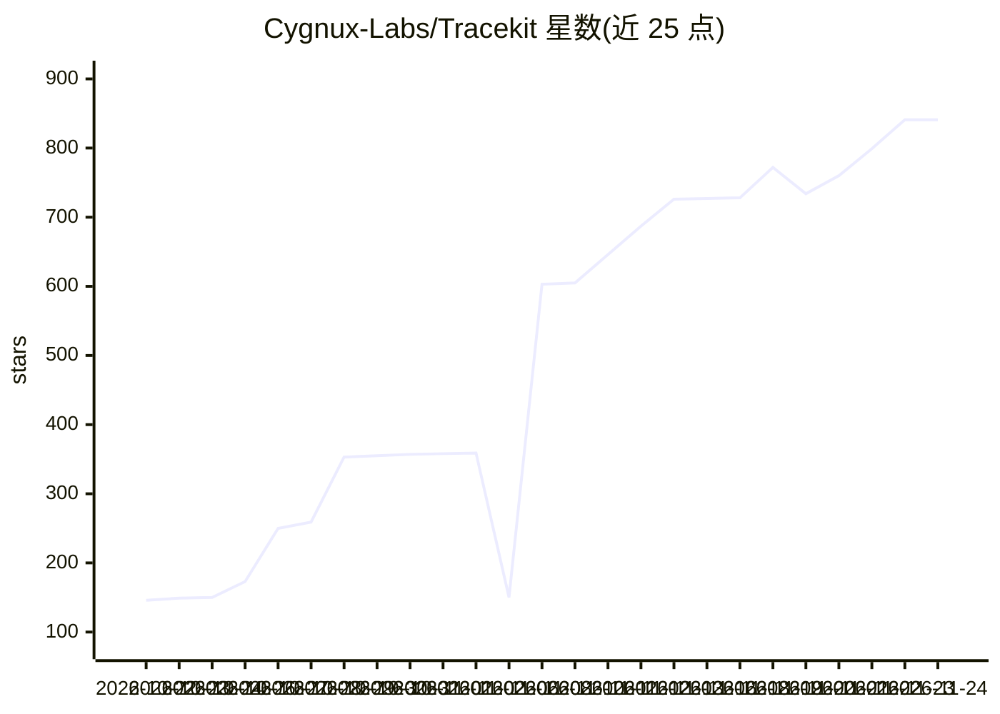

# Cygnux-Labs/Tracekit

⭐ 837 · Python · MIT · 推送 2026-11-24 · [GitHub](https://github.com/Cygnux-Labs/Tracekit) · [官网](https://cygnuxlabs.com/tracekit) · 组织维护

**给 AI agent 工具调用做防篡改记录与策略门控的审计工具**

Tracekit 嵌入 agent 的工具调用路径：在每次调用运行前做允许/拒绝/人工审批的判定，并将调用、判定与结果签名写入 agent 无法触及的签名进程持有的哈希链日志；每次运行可导出为 .tkb 文件供任何人在浏览器中离线验证。项目参照 Certificate Transparency 设计，由独立 witness 联签，提供 Python/TypeScript/Go 验证器，MIT 许可，可部署在自有机器上。支持 Claude Code、LangChain、LangGraph、MCP 等 42 个 agent 与框架的接入。

## 筛选速览

| 维度 | 判定 | 备注 |
|---|---|---|
| AI 角色 | `ai-ecosystem` | LLM/agent 周边工具 |
| 许可风险 | `permissive` | MIT |
| 部署形态 | `self-host` | docker 或自建部署 |
| 模型依赖 | — | README 未给出锁定关系 |
| 硬件要求 | — | 无带数字的原话,不猜 |
| 安装摩擦 | `low` | 无编译、无系统依赖或容器化 |
| 成熟度 | — | 结构信号不足 |

## 能力要点

- 运行前对每次工具调用做 allow/deny/人工审批判定，审批绑定精确参数
- 签名事件写入 agent 不可达的哈希链日志，篡改处验证即报 FAILED
- 导出 .tkb 文件，可在浏览器离线验证
- 提供 Python 与 TypeScript SDK，npm/pip 均可安装

## 适用场景

- 上线 agent 前给危险调用（删除、转账、force-push）加人工审批关卡
- 向企业客户交付可自行离线核验的运行记录
- 安全团队需要一个跨框架的统一策略控制点
- 审计人员核验 agent 行为记录并映射合规框架

## 场景标签

`网络安全` · 领域:学习与行业

## 证据(README 行号)

> L40: |**Stop**|Checks every tool call *before it runs*: allow, deny, or hold it for a person. An approval covers exactly
> L41: |**Record**|Signs every call, decision and result into a hash chain held by a signer the agent can't reach. A lost 
> L130: `tracekit.instrument()` starts a dev signer (or reuses the running one) and gates and records every tool and model

## 星数曲线

2026-10-22 146 → 2026-11-24 841（+695）

---
*卡片 v1 · prompt 1.4 · 生成 2026-11-24 · 置信度 mid · 依据 README sha `ba162cc08250` · [字段定义](../../DATASET.md)*
