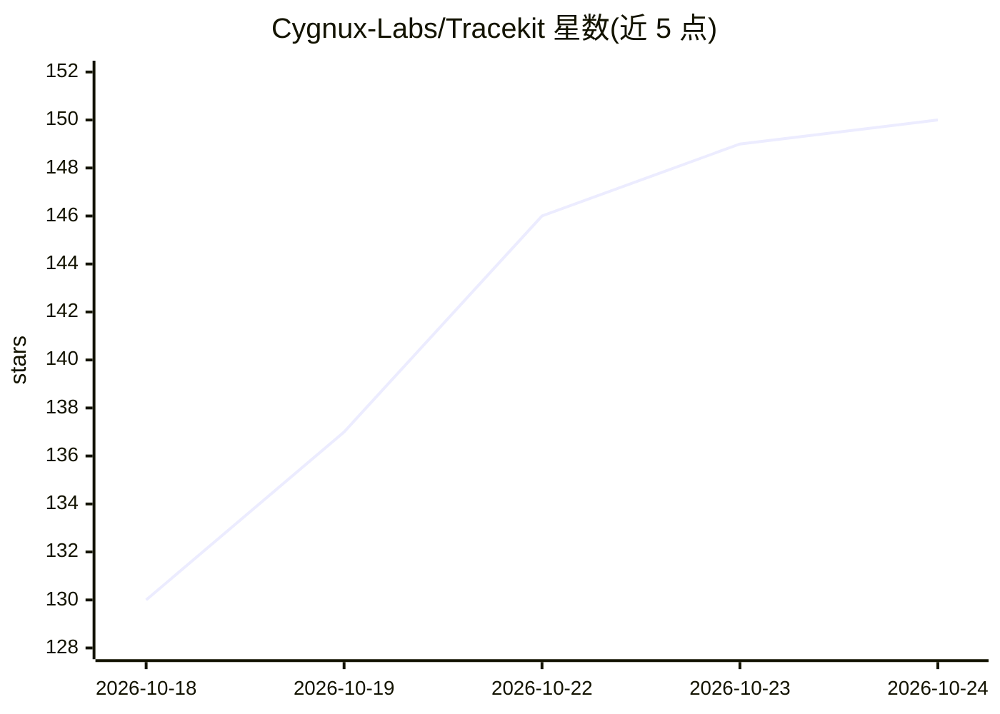

# Cygnux-Labs/Tracekit

⭐ 150 · Python · MIT · 推送 2026-10-23 · [GitHub](https://github.com/Cygnux-Labs/Tracekit) · [官网](https://cygnuxlabs.com/tracekit) · 组织维护

**AI agent 的防篡改追踪与策略门控库：记录并核验 agent 每步行为**

面向 AI agent 的可观测与安全库：在工具调用执行前做允许/拒绝/人工保留的判定，将每次调用与决策签名进哈希链，生成单个 .tkb 文件可在离线核验。采用类似 Certificate Transparency 的追加式日志与独立见证人共签机制。提供 Python 与 TypeScript SDK，集成 25 种 agent 框架（Claude Code、OpenAI Agents SDK、LangChain/LangGraph、MCP 等，部分实验性）。核心稳定、其余组件为实验性；dev 模式对与 agent 同用户运行的场景不提供防护，日志之外的路径行为不被记录。MIT 许可。

## 筛选速览

| 维度 | 判定 | 备注 |
|---|---|---|
| AI 角色 | `ai-ecosystem` | LLM/agent 周边工具 |
| 许可风险 | `permissive` | MIT |
| 部署形态 | `self-host` | docker 或自建部署 |
| 模型依赖 | — | README 未给出锁定关系 |
| 硬件要求 | — | 无带数字的原话,不猜 |
| 安装摩擦 | `low` | 无编译、无系统依赖或容器化 |
| 成熟度 | `idea` | |

## 能力要点

- 每次工具调用前判定 allow/deny/hold，参数绑定的一次性审批
- 签名哈希链 + 见证人共签的防篡改运行记录，可离线核验
- 跨检查：对照 LLM 网关/会话记录核验 agent 上报的调用，标记差异
- tracekit why 通过重放定位引发动作的输入来源

## 适用场景

- 审计 coding agent 的操作记录，检测日志被事后篡改
- 在生产中拦截危险工具调用并要求人工审批
- 满足 EU AI Act / ISO 42001 / NIST AI RMF 等框架下的 agent 行为合规留痕

## 场景标签

`LLM 可观测性` `网络安全` · 领域:评测与运维

## 证据(README 行号)

> L5: **Tracekit checks every tool call your agent makes before it runs, signs each call and decision into a hash chain,
> L72: `tracekit.instrument()` starts a dev signer (or reuses the running one) and gates and records every tool and model 
> L153: |**Execution control**|Each call is checked before it runs. A denied call is blocked; a held call runs only after 

## 星数曲线

2026-10-18 130 → 2026-10-24 150（+20）

---
*卡片 v1 · prompt 1.4 · 生成 2026-10-22 · 置信度 mid · 依据 README sha `2096bd6bd5a9` · [字段定义](../../DATASET.md)*
