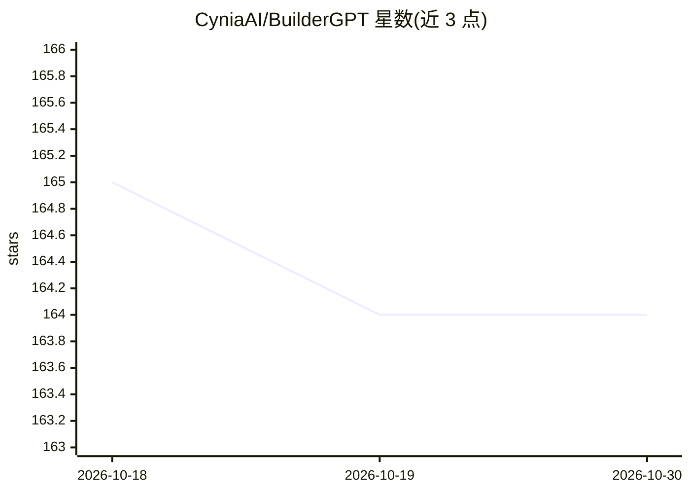

# CyniaAI/BuilderGPT

⭐ 164 · JavaScript · Apache-2.0 · 推送 2026-02-22 · [GitHub](https://github.com/CyniaAI/BuilderGPT) · [官网](https://cynia.dev) · 组织维护

**用自然语言生成 Minecraft 建筑结构（.schem/.mcfunction）的组件**

Cynia Agents 框架的组件：用户描述建筑，由配置的 LLM 生成可直接导入游戏的 .schem 文件或 .mcfunction 脚本（可经 WorldEdit 导入）。安装方式为复制组件目录到框架 components/、pip 安装依赖并在 Streamlit UI 中启用；在组件页面选择 Minecraft 版本与导出格式即可生成。注意：项目已声明开发暂停（Development Paused），官方推荐迁移到后继项目 MineClawd。提示词与 JS 建筑表示法受 MCBench 启发但代码独立实现。

## 筛选速览

| 维度 | 判定 | 备注 |
|---|---|---|
| AI 角色 | `ai-native` | 本体是模型或模型工具 |
| 许可风险 | `permissive` | Apache-2.0 |
| 部署形态 | `library` | 以包/库形式分发 |
| 模型依赖 | — | README 未给出锁定关系 |
| 硬件要求 | — | 无带数字的原话,不猜 |
| 安装摩擦 | `low` | 无编译、无系统依赖或容器化 |
| 成熟度 | — | 结构信号不足 |

## 能力要点

- 自然语言描述生成 Minecraft 建筑
- 导出 .schem 或 .mcfunction 格式，可用 WorldEdit 导入
- 作为 Cynia Agents 组件运行，通过 Streamlit UI 使用

## 适用场景

- 我想用一句话让 AI 帮我生成 Minecraft 建筑
- 批量生成可导入游戏的建筑蓝图或脚本

## 场景标签

`代码生成` · 领域:编码与开发

## 证据(README 行号)

> L25: A generative Minecraft structure tool for the Cynia Agents framework.
> L27: BuilderGPT lets you describe a building and have a language model produce a ready-to-use schematic. The component o

## 星数曲线

2026-10-18 165 → 2026-10-30 164（-1）

---
*卡片 v1 · prompt 1.4 · 生成 2026-10-22 · 置信度 high · 依据 README sha `3b6e11d465e9` · [字段定义](../../DATASET.md)*
