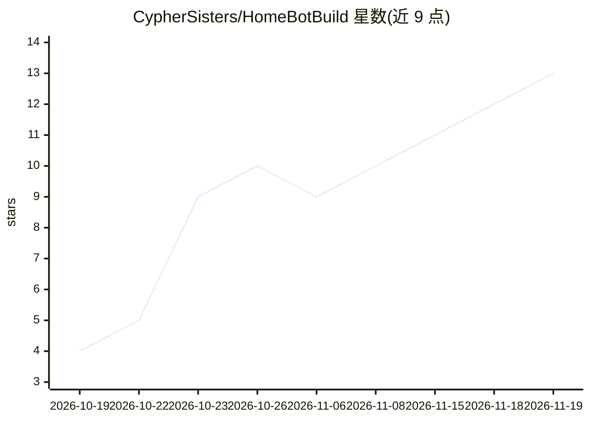

# CypherSisters/HomeBotBuild

⭐ 13 · Python · Apache-2.0 · 推送 2026-10-18 · [GitHub](https://github.com/CypherSisters/HomeBotBuild) · [官网](https://www.puffpai.com) · 组织维护

**Windows/Linux PC 上的私有离线家庭 AI 助手**

自托管的本地家庭 AI 助手：通过 Ollama 运行本地 LLM，安装向导按机器 RAM 自动选择合适模型，配套浏览器仪表盘、聊天界面与离线知识库（读取 Kiwix ZIM 文件，含 66 个应急准备类知识包清单），并可选接入 Home Assistant 控制与语音助手。所有出站连接经命名的 Bridge 开关控制，默认关闭，无云账户与订阅。最低 2 GB RAM 可跑，8 GB 适配 7B 模型。安装走 git clone 加平台安装脚本，首次安装需联网。

## 筛选速览

| 维度 | 判定 | 备注 |
|---|---|---|
| AI 角色 | `ai-native` | 本体是模型或模型工具 |
| 许可风险 | `permissive` | Apache-2.0 |
| 部署形态 | `self-host` | docker 或自建部署 |
| 模型依赖 | local-ok | 支持本地模型 |
| 硬件要求 | — | 无带数字的原话,不猜 |
| 安装摩擦 | `low` | 无编译、无系统依赖或容器化 |
| 成熟度 | — | 结构信号不足 |

## 能力要点

- 向导读取硬件并按 RAM 选择合适的本地模型
- 离线知识库：66 个 Kiwix 知识包（含医学参考与应急准备资料）
- 所有出站连接由 Bridge 开关控制且默认关闭
- 可选 Home Assistant 控制与语音助手

## 适用场景

- 断网环境下在家运行私人 AI 助手与离线知识库
- 按家中旧电脑的配置自动匹配本地模型
- 应急准备场景查阅离线医学与自救参考资料

## 场景标签

`AI 助手` · 领域:对话与助手

## 证据(README 行号)

> L5: HomeBot is a self-hosted, local AI assistant for your family and home that runs
> L6: on a Windows or Linux PC you already own (64-bit Windows 10/11 or Linux): a local LLM through Ollama, a
> L16: Ollama. The wizard reads your hardware and picks

## 星数曲线

2026-10-19 4 → 2026-11-19 13（+9）

---
*卡片 v1 · prompt 1.4 · 生成 2026-11-18 · 置信度 mid · 依据 README sha `d239a6d9627d` · [字段定义](../../DATASET.md)*
