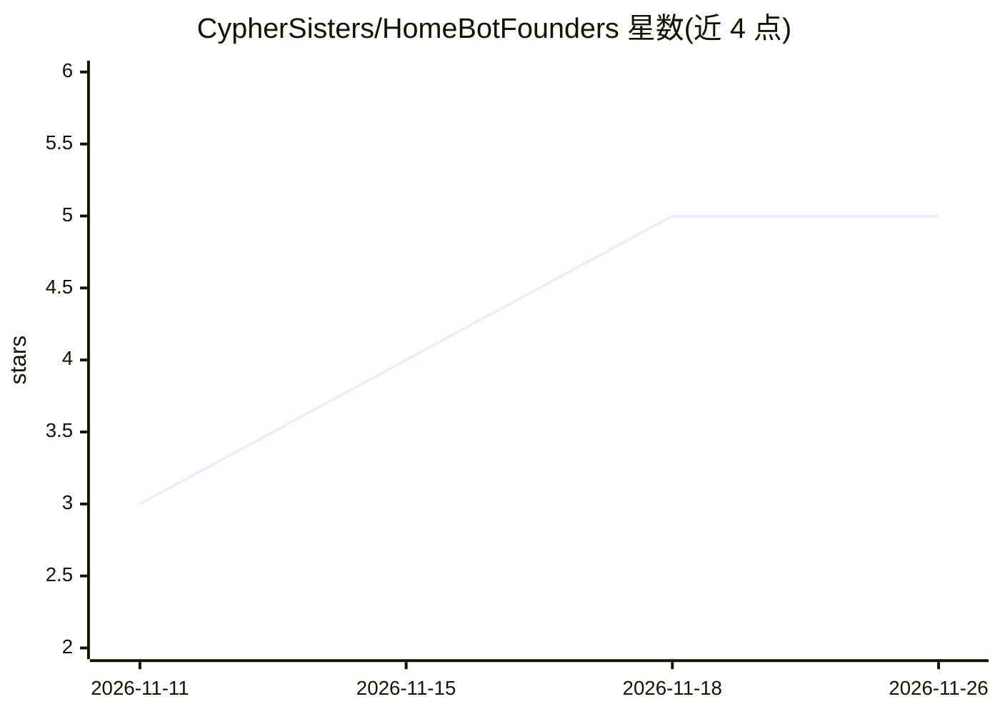

# CypherSisters/HomeBotFounders

⭐ 5 · Python · Apache-2.0 · 推送 2026-10-22 · [GitHub](https://github.com/CypherSisters/HomeBotFounders) · [官网](https://www.puffpai.com) · 组织维护

**给家庭用户的 Jetson 离线私有 AI 助手**

自托管在用户自有 NVIDIA Jetson AGX Orin 上的家庭 AI 助手：通过 Ollama 运行本地 LLM，Whisper/Piper 组成带唤醒词的语音链路，可选接入 Home Assistant 控制家居，并可从 Kiwix ZIM 文件构建离线知识库全文索引。无云账户与订阅，每个对外连接对应一个命名 Bridge 开关且默认关闭。要求 64 GB Orin、NVMe、USB 麦克风阵列与音箱；知识包与地图数据需自行下载构建，安装器尚未在全新 Orin 上端到端验证。

## 筛选速览

| 维度 | 判定 | 备注 |
|---|---|---|
| AI 角色 | `ai-native` | 本体是模型或模型工具 |
| 许可风险 | `permissive` | Apache-2.0 |
| 部署形态 | `library` | 以包/库形式分发 |
| 模型依赖 | local-ok | 支持本地模型 |
| 硬件要求 | — | 无带数字的原话,不猜 |
| 安装摩擦 | `low` | 无编译、无系统依赖或容器化 |
| 成熟度 | — | 结构信号不足 |

## 能力要点

- 本地 LLM 对话 + 唤醒词语音（Whisper 转写、Piper 朗读）
- 66 个 Kiwix 离线知识包清单，断网下全文检索问答
- 命名 Bridge 出站开关默认全关；7 个 agent 协作并经 Drawbridge 审查
- 可选 Home Assistant 控制与离线地图路线（Valhalla/Photon）

## 适用场景

- 断网或应急时在本地查医学与应急参考资料
- 语音或聊天方式与本地模型对话并控制家居
- 上传家庭文档在本地检索问答

## 场景标签

`AI 助手` `语音 Agent` `文档问答` · 领域:对话与助手

## 证据(README 行号)

> L5: HomeBot Founders Edition is a self-hosted, local AI assistant for your home that
> L82: |Voice|Say "hey puffpai". Whisper turns speech into text on the Orin, the brain answers, and Piper speaks up to two
> L86: |The agent team|Seven agents. Concierge talks to you and holds no keys. Steward runs the house and media. Archivist

## 星数曲线

2026-11-11 3 → 2026-11-26 5（+2）

---
*卡片 v1 · prompt 1.4 · 生成 2026-11-21 · 置信度 high · 依据 README sha `8f3591575394` · [字段定义](../../DATASET.md)*
