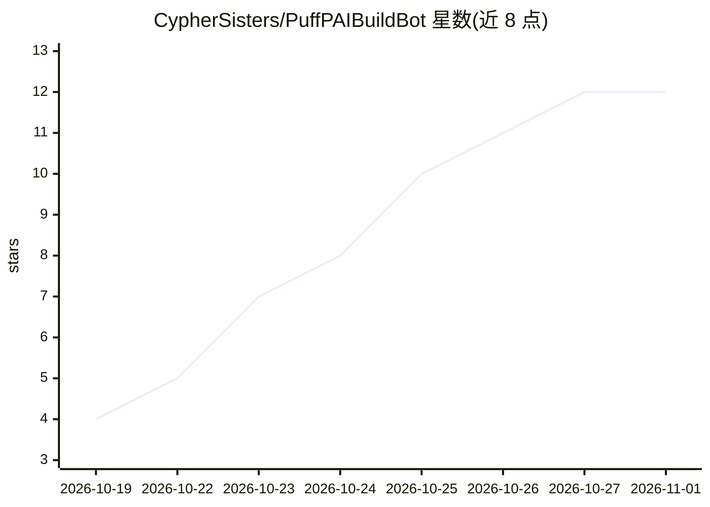

# CypherSisters/PuffPAIBuildBot

⭐ 12 · Python · Apache-2.0 · 推送 2026-10-24 · [GitHub](https://github.com/CypherSisters/PuffPAIBuildBot) · [官网](https://www.puffpai.com) · 组织维护

**本机自建私人 AI 机器人的构建向导：说需求，生成计划并搭建**

面向个人用户的本地 AI bot 构建工具：用户用自然语言描述想要的机器人，向导检测本机硬件（内存/显卡/磁盘），推荐可运行的本地模型（经 Ollama），检索可学的离线书籍（Kiwix、Wikipedia、Project Gutenberg、OpenStax）、实时信息卡片与可用服务，展示单一计划，经确认后逐步搭建。每个外部服务有独立开关，可完全离线运行；个人数据存入带 PIN 的加密 vault。支持 Windows/Linux/macOS，安装器可代装 Python、Node.js、Ollama，Docker 非必需。构建过程由 Toolsmith 查找应用，可选将 Toolsmith 交给 Anthropic Claude（自带 key）。macOS 支持为新加，README 自述尚无人在自己 Mac 上用过。

## 筛选速览

| 维度 | 判定 | 备注 |
|---|---|---|
| AI 角色 | `ai-native` | 本体是模型或模型工具 |
| 许可风险 | `permissive` | Apache-2.0 |
| 部署形态 | `library` | 以包/库形式分发 |
| 模型依赖 | local-ok | 支持本地模型 |
| 硬件要求 | — | 无带数字的原话,不猜 |
| 安装摩擦 | `low` | 无编译、无系统依赖或容器化 |
| 成熟度 | — | 结构信号不足 |

## 能力要点

- 向导按本机内存推荐适配模型，过大模型不予提供
- 每个外部服务单独开关，bot 可完全离线运行
- 知识来源含 Kiwix 离线库、Wikipedia 定制书、Project Gutenberg、OpenStax
- 安装器从零代装 Python、Node.js、Ollama，Docker 永不必需

## 适用场景

- 不懂技术的用户在本机搭建一个私人 AI 助手
- 给 bot 离线学书（如恐龙、园艺）并本地问答
- 需要逐项控制外部服务开关、保护个人数据的家庭场景
- 通过手机/笔记本配对码远程访问家里的 bot

## 场景标签

`AI 助手` · 领域:对话与助手

## 证据(README 行号)

> L3: BuildBot makes your own AI bot, on your own computer. You say what bot you
> L8: The bot's brain runs on your computer. One page lists every outside service
> L128: - **How it thinks.** The AI model it will use, and the team of helpers inside.

## 星数曲线

2026-10-19 4 → 2026-11-01 12（+8）

---
*卡片 v1 · prompt 1.4 · 生成 2026-11-01 · 置信度 mid · 依据 README sha `2748a53750db` · [字段定义](../../DATASET.md)*
