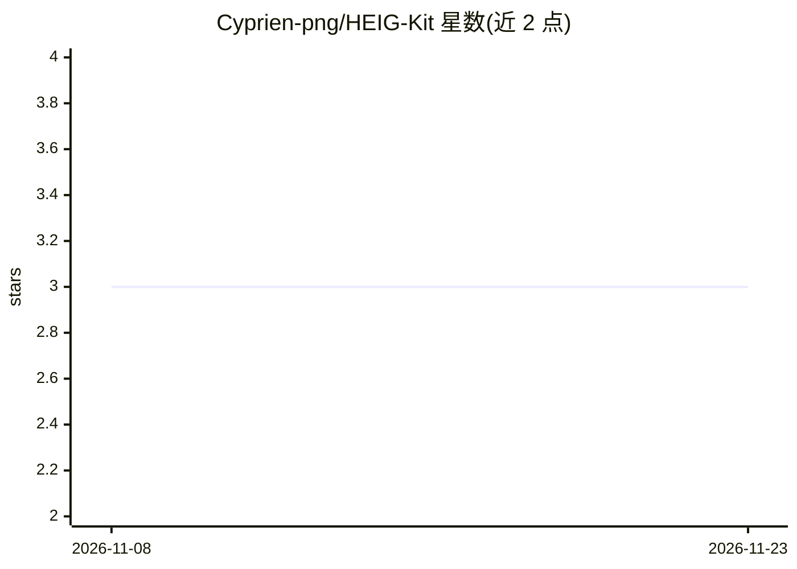

# Cyprien-png/HEIG-Kit

⭐ 3 · TypeScript · MIT · 推送 2026-11-22 · [GitHub](https://github.com/Cyprien-png/HEIG-Kit) · 个人维护

**HEIG-VD 学生的终端/claude课程工具箱：课表成绩与RAG课程问答**

面向 HEIG-VD 学生的模块化 CLI 工具箱，覆盖课表/成绩/考勤查询（GAPS）、Cyberlearn 作业与截止日期、Markdown 转 PDF/Word 文档导出、manim 数学动画、法语语音讲解及 Web 端日历/闪卡/纠错。核心 teacher 模块为 RAG：经 Moodle 官方 API 拉取课程文档，本地索引后由 AI 助手引用课程内容作答。以 Claude Code 插件与本地 MCP server 形式暴露全部功能，凭据与数据均存本机。需 Node.js 20、SWITCH edu-ID 账户；knowledge 模块需 8 GB 内存的 Docker。

## 筛选速览

| 维度 | 判定 | 备注 |
|---|---|---|
| AI 角色 | `ai-enhanced` | 去掉 AI 部分产品仍成立 |
| 许可风险 | `permissive` | MIT |
| 部署形态 | `library` | 以包/库形式分发 |
| 模型依赖 | — | README 未给出锁定关系 |
| 硬件要求 | — | 无带数字的原话,不猜 |
| 安装摩擦 | `medium` | 含编译或系统依赖之一 |
| 成熟度 | — | 结构信号不足 |

## 能力要点

- RAG teacher：索引 Cyberlearn 课程文档，回答时引用出处
- 以 CLI、MCP server、Claude Code 插件三种形式提供同一套功能
- 本地运行：索引数据不出本机，支持本地模型时数据不出计算机
- 模块化安装，各模块自动安装自身依赖（macOS/Linux/Windows）

## 适用场景

- 查询课表、成绩、缺勤与作业截止日期
- 让 AI 助手基于自己课程资料讲解概念、出练习题和模拟考试
- 把笔记导出为带公式和图表的 PDF
- 为拍照片的作业生成批改与复习卡片

## 场景标签

`RAG` `文档问答` · 领域:知识与检索

## 证据(README 行号)

> L27: **The teacher is a RAG** (retrieval-augmented generation): HEIG-Kit downloads the documents of your Cyberlearn cour
> L89: **Other AI assistants.** Every feature is also exposed by an MCP server running on
> L9: > HEIG-Kit is an independent student project, not affiliated with HEIG-VD, HES-SO or SWITCH. See Disclaimer.

## 星数曲线

2026-11-08 3 → 2026-11-23 3（+0）

---
*卡片 v1 · prompt 1.4 · 生成 2026-11-22 · 置信度 high · 依据 README sha `2d1eb7736c11` · [字段定义](../../DATASET.md)*
