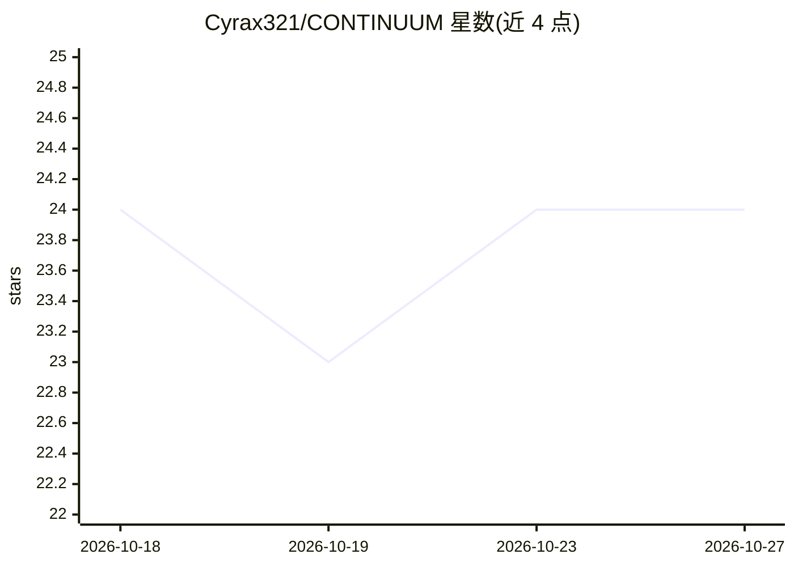

# Cyrax321/CONTINUUM

⭐ 24 · Python · Apache-2.0 · 推送 2026-10-26 · [GitHub](https://github.com/Cyrax321/CONTINUUM) · [官网](https://continuum-nu-six.vercel.app) · 个人维护 · 中文 README

**长时运行 AI agent 的可验证语义恢复与检查点库**

面向长时运行 AI agent 的 Python 库与 CLI/MCP 服务器：以语义检查点（非会话转储）、幂等动作账本（拒绝重复副作用）、哈希链防篡改事件日志实现崩溃后恢复。恢复前对每个检查点组件做环境重校验，agent 报告的进度标记为需人工复核而非自证。框架无关，提供 Generic/OpenAI Agents SDK/LangGraph/LangChain 适配器、deny-by-default MCP 服务器（13 个工具）、编码 CLI 钩子（Claude Code/Gemini/Codex）、SQLite/Postgres 存储与仪表盘。核心运行时依赖仅 pydantic>=2.7，Python 3.11+。

## 筛选速览

| 维度 | 判定 | 备注 |
|---|---|---|
| AI 角色 | `ai-ecosystem` | LLM/agent 周边工具 |
| 许可风险 | `permissive` | Apache-2.0 |
| 部署形态 | `self-host` | docker 或自建部署 |
| 模型依赖 | — | README 未给出锁定关系 |
| 硬件要求 | — | 无带数字的原话,不猜 |
| 安装摩擦 | `low` | 无编译、无系统依赖或容器化 |
| 成熟度 | — | 结构信号不足 |

## 能力要点

- 语义检查点+环境重校验+来源感知状态的三段式恢复机制
- 幂等动作账本：claim-before-fire，拒绝重复外部副作用
- 哈希链防篡改事件日志与完整性校验
- deny-by-default MCP 服务器（13 工具、只读/变更分离、调用方白名单）

## 适用场景

- 长时运行编码 agent 崩溃后从语义检查点恢复，避免重复工作与副作用
- 为 CrewAI/AutoGen/LangGraph 等框架的 agent 挂接可验证检查点
- 通过 MCP 服务器对 agent 运行状态做受控读写与审计

## 场景标签

`Agent 框架` `Agent 记忆` · 领域:Agent 开发

## 证据(README 行号)

> L6:  log, all exposed as a deny-by-default MCP server. Framework-agnostic,
> L134: |Harness|How does the agent call tools and make progress toward a goal?|Outside CONTINUUM. Wiring points ship in `

## 星数曲线

2026-10-18 24 → 2026-10-27 24（+0）

---
*卡片 v1 · prompt 1.4 · 生成 2026-10-27 · 置信度 high · 依据 README sha `2487b66b6ce3` · [字段定义](../../DATASET.md)*
