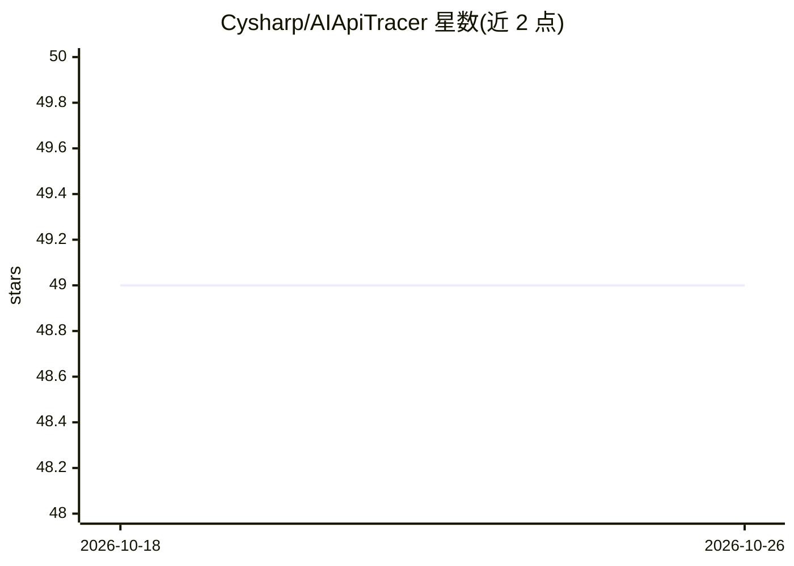

# Cysharp/AIApiTracer

⭐ 49 · C# · MIT · 推送 2026-10-06 · [GitHub](https://github.com/Cysharp/AIApiTracer) · 组织维护

**本地开发环境的 AI API 反向代理：拦截并追踪 AI 服务请求响应**

面向本地开发环境的反向代理工具：将 OpenAI、Anthropic、Azure OpenAI、xAI 及 OpenAI 兼容 API 的请求端点改为本地代理地址，即可在浏览器中查看人类可读的请求与响应内容。数据仅存内存，最多保留 1000 条记录，不做持久化。提供 Docker 镜像与预编译二进制两种运行方式。作者声明其不适用于审计、监控或团队使用场景。

## 筛选速览

| 维度 | 判定 | 备注 |
|---|---|---|
| AI 角色 | `ai-ecosystem` | LLM/agent 周边工具 |
| 许可风险 | `permissive` | MIT |
| 部署形态 | `desktop` | 安装包/桌面程序 |
| 模型依赖 | locked-api |  |
| 硬件要求 | — | 无带数字的原话,不猜 |
| 安装摩擦 | `low` | 无编译、无系统依赖或容器化 |
| 成熟度 | — | 结构信号不足 |

## 能力要点

- 支持 OpenAI / Anthropic / Azure OpenAI / xAI / OpenAI 兼容 API 的端点代理
- 内存存储最多 1000 条追踪记录，无数据持久化
- 提供 Docker 镜像（ghcr.io/cysharp/aiapitracer）与预编译二进制

## 适用场景

- 本地开发时查看 AI API 的请求与响应内容
- 调试 AI 客户端应用与各 AI 服务间的交互
- 本地追踪 Claude Code 等 CLI 工具的 API 调用

## 场景标签

`LLM 可观测性` · 领域:评测与运维

## 证据(README 行号)

> L3: A reverse proxy for local development environments that intercepts requests to AI services like OpenAI, Anthropic, A
> L9: - Monitor locally without using external services

## 星数曲线

2026-10-18 49 → 2026-10-26 49（+0）

---
*卡片 v1 · prompt 1.4 · 生成 2026-10-25 · 置信度 high · 依据 README sha `72a1d9291dc8` · [字段定义](../../DATASET.md)*
