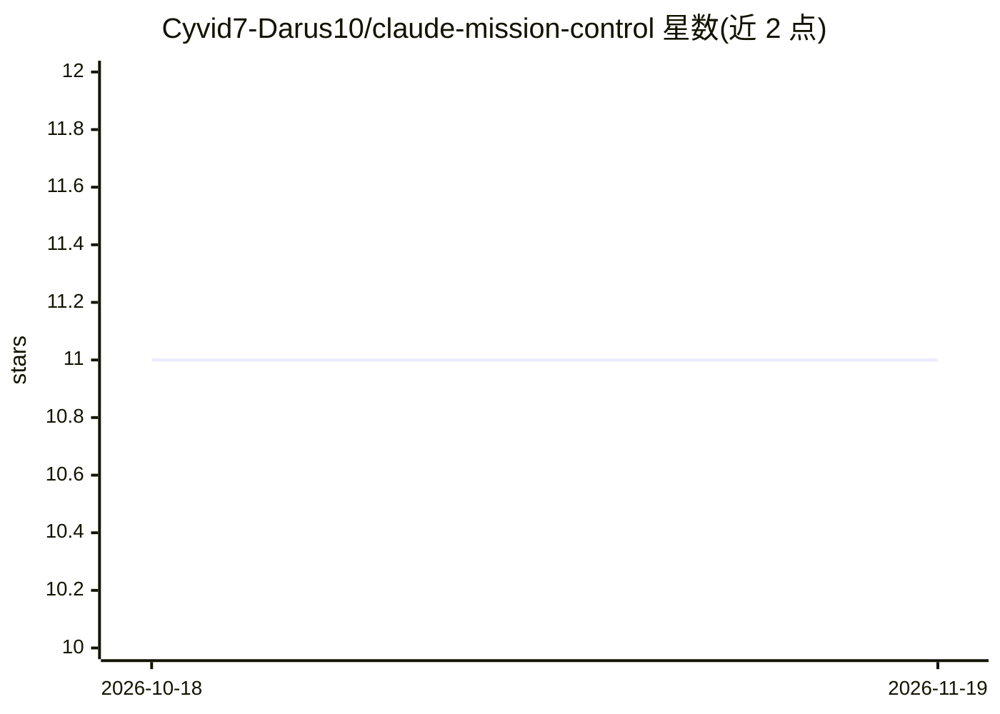

# Cyvid7-Darus10/claude-mission-control

⭐ 11 · TypeScript · Apache-2.0 · 推送 2026-08-01 · [GitHub](https://github.com/Cyvid7-Darus10/claude-mission-control) · 个人维护

**为 Claude Code 多 agent 提供实时监控仪表盘与指令下发**

面向同时运行多个 Claude Code agent 的开发者的实时监控面板：通过向 Claude Code 安装 hooks 采集活动，浏览器仪表盘展示各 agent 状态、工具调用时间线与文件改动统计；读取 ~/.claude/projects/ 下的 JSONL 会话日志按 token 与模型定价计算实际 API 成本；自动从 agent 活动生成任务板，检测 STUCK/LOOP/SPIRAL 等异常并发出浏览器通知；支持从仪表盘或手机（扫码登录）向 agent 注入指令，带 6 位访问码与 7 层安全防护。仅 2 个依赖，无构建步骤。指令只能在 agent 下一次工具调用时送达。

## 筛选速览

| 维度 | 判定 | 备注 |
|---|---|---|
| AI 角色 | `ai-ecosystem` | LLM/agent 周边工具 |
| 许可风险 | `permissive` | Apache-2.0 |
| 部署形态 | `library` | 以包/库形式分发 |
| 模型依赖 | — | README 未给出锁定关系 |
| 硬件要求 | — | 无带数字的原话,不猜 |
| 安装摩擦 | `low` | 无编译、无系统依赖或容器化 |
| 成熟度 | — | 结构信号不足 |

## 能力要点

- 多 agent 实时仪表盘：状态、工具调用、diff 统计、会话时长
- 基于 JSONL 日志的真实 token 成本核算与按模型/日期/会话拆分
- 异常检测告警：STUCK、LOOP、SPIRAL、ERRORS、MARATHON
- 手机 QR 扫码接入，支持远程发送指令

## 适用场景

- 同时跑多个 Claude Code agent 时在一个页面集中监控
- 发现陷入循环或卡住的 agent 并远程下发纠正指令
- 跟踪多 agent 使用的 token 成本与上下文窗口健康度

## 场景标签

`多智能体` · 领域:Agent 开发

## 证据(README 行号)

> L26: **Mission Control** gives you a real-time command center for all your Claude Code agents. One browser tab. Every ag
> L89: This adds hooks to `~/.claude/settings.json` so Claude Code reports activity to Mission Control. You only need to d

## 星数曲线

2026-10-18 11 → 2026-11-19 11（+0）

---
*卡片 v1 · prompt 1.4 · 生成 2026-11-19 · 置信度 high · 依据 README sha `cf5c4aa1adcf` · [字段定义](../../DATASET.md)*
