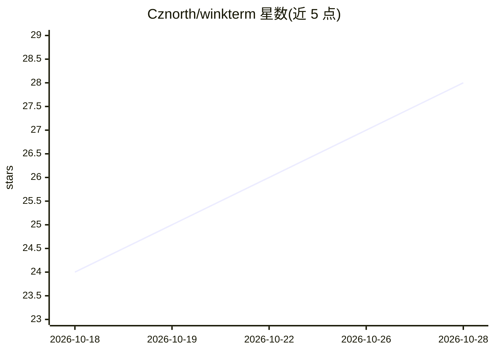

# Cznorth/winkterm

⭐ 28 · Python · MIT · 推送 2026-10-11 · [GitHub](https://github.com/Cznorth/winkterm) · [官网](https://cznorth.github.io/winkterm/) · 个人维护 · 中文 README

**AI 直接在用户终端内键入命令的开源 AI 终端**

基于共享 PTY 的 Web/桌面终端：AI 与用户在同一终端进程协作，可直接把命令写入输入行（用户按回车执行、可编辑或取消），支持 # 前缀的终端内对话、侧边栏多会话聊天、SSH 远程连接与文件传输、Docker 部署与 Windows/macOS 桌面安装包。多模型接入：OpenAI 兼容协议可指向 Ollama/vLLM 等，或通过 Codex OAuth 使用 ChatGPT 订阅；默认需配置 API key（Anthropic/OpenAI）。另提供带鉴权的 HTTP Agent API，供 Claude Code、Cursor 等外部 agent 驱动终端、SSH 与文件传输，附可安装技能（SKILL.md）。

## 筛选速览

| 维度 | 判定 | 备注 |
|---|---|---|
| AI 角色 | `ai-native` | 本体是模型或模型工具 |
| 许可风险 | `permissive` | MIT |
| 部署形态 | `desktop` | 安装包/桌面程序 |
| 模型依赖 | local-ok | 支持本地模型 |
| 硬件要求 | — | 无带数字的原话,不猜 |
| 安装摩擦 | `low` | 无编译、无系统依赖或容器化 |
| 成熟度 | — | 结构信号不足 |

## 能力要点

- 共享 PTY：AI 直接写入终端输入行，人工按回车执行
- 带鉴权的 HTTP Agent API：外部 agent 可驱动终端/SSH/文件传输，附可安装技能
- 多模型接入：OpenAI 兼容端点（Ollama/vLLM 等）或 Codex OAuth 使用 ChatGPT 订阅
- Docker 一键部署与 Windows/macOS 桌面安装包，内置中英文 UI

## 适用场景

- 在同一个 SSH 会话里让 AI 定位命令错误并预填修复命令
- 让 Claude Code/Cursor 等外部 agent 通过 API 远程驱动终端执行运维任务
- 自托管一个支持多模型、可远程访问的带 AI 终端

## 场景标签

`编码 Agent` `AI 助手` · 领域:编码与开发

## 证据(README 行号)

> L5:  AI that shares your terminal session.
> L66: - **Multi-Model Support** — Bring your own LLM (OpenAI, Anthropic, Ollama, any compatible endpoint), or sign in wit
> L150: |Feature|WinkTerm|Warp|Tabby|Claude Code|

## 星数曲线

2026-10-18 24 → 2026-10-28 28（+4）

---
*卡片 v1 · prompt 1.4 · 生成 2026-10-26 · 置信度 low · 依据 README sha `95b5c72be274` · [字段定义](../../DATASET.md)*
