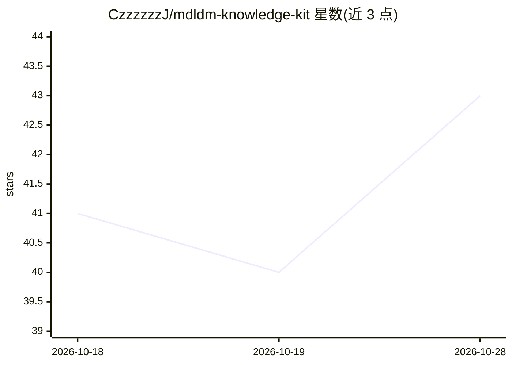

# CzzzzzzJ/mdldm-knowledge-kit

⭐ 43 · TypeScript · Apache-2.0 · 推送 2026-10-16 · [GitHub](https://github.com/CzzzzzzJ/mdldm-knowledge-kit) · [官网](https://www.mdldm.club) · 个人维护 · 中文 README

**创作者独立知识站脚手架：图文/视频、会员订阅与单课购买，由 Coding Agent 搭建**

基于 Next.js/pnpm 的开源知识站脚手架，从麦当mdldm 真实知识站抽离公共能力：发布图文课/视频课、全站会员与单课购买、按权益阅读播放下载、站长后台管理品牌/内容/订单。设计为在 Codex、Claude Code 等 Coding Agent 中打开仓库执行 Prompt 完成搭建与部署，官方线上路径限定 Agent + Serverless（Vercel + MongoDB Atlas），Docker Compose 仅用于本地 MongoDB 而非生产方案。Apache-2.0 授权，另存在付费教程《麦当知识站实战》但免费核心不依赖它。

## 筛选速览

| 维度 | 判定 | 备注 |
|---|---|---|
| AI 角色 | `ai-enhanced` | 去掉 AI 部分产品仍成立 |
| 许可风险 | `permissive` | Apache-2.0 |
| 部署形态 | `self-host` | docker 或自建部署 |
| 模型依赖 | — | README 未给出锁定关系 |
| 硬件要求 | — | 无带数字的原话,不猜 |
| 安装摩擦 | `low` | 无编译、无系统依赖或容器化 |
| 成熟度 | `idea` | |

## 能力要点

- 图文课与视频课共用同一套商品、订单和权益系统
- 默认 Manual Payment，无自动支付账号可先经营并人工确认订单
- Agent + Serverless 单一官方部署路线，生产最低仅需 4 个环境变量
- pnpm run doctor 生成脱敏 Agent Report，不自动创建 Issue

## 适用场景

- 我想持有自己代码和数据，经营带会员订阅的知识站
- 让 Claude Code/Codex 帮我把站点从搭建到部署跑通
- 不录视频、以文档型教程形式发布和销售课程

## 场景标签

`知识库管理` · 领域:知识与检索

## 证据(README 行号)

> L3: **把项目交给你的 Agent，搭建一个支持图文、视频、会员订阅和单课购买的独立知识站。**
> L68: 在 Codex、Claude Code 或其他 Coding Agent 中打开仓库，然后直接发送：
> L64: 第一版只维护 **Agent + Serverless** 这一条线上路径。Docker Compose 只负责本地 MongoDB，不是生产部署方案。

## 星数曲线

2026-10-18 41 → 2026-10-28 43（+2）

---
*卡片 v1 · prompt 1.4 · 生成 2026-10-25 · 置信度 mid · 依据 README sha `3b0b1c82a1ac` · [字段定义](../../DATASET.md)*
