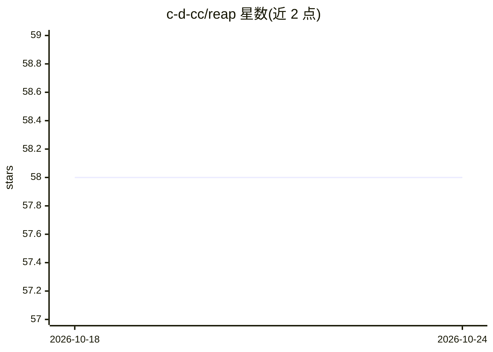

# c-d-cc/reap

⭐ 59 · TypeScript · 推送 2026-09-21 · [GitHub](https://github.com/c-d-cc/reap) · [官网](https://reap.cc/) · 个人维护

**AI 与人协作的自进化开发流水线，跨代际演进软件项目**

面向使用 Claude Code 或 OpenCode 的开发者的 CLI 工具：以代际（generation）为单位组织开发——学习、规划、实现、验证、完成五阶段，每代结束时把经验回写到知识库（Genome/Environment）。AI 在每次会话启动时自动恢复项目上下文，按愿景与现状的差距自动选目标，人通过自然语言反馈作为唯一适应度信号。提供 genome-first 合并工作流、backlog 跨代际传递、两级压缩的 Lineage 归档与 Cruise 模式（预批 N 代自主执行）。通过斜杠命令操作，npm 全局安装，需 Node.js v18+ 与受支持的 AI agent。

## 筛选速览

| 维度 | 判定 | 备注 |
|---|---|---|
| AI 角色 | `ai-ecosystem` | LLM/agent 周边工具 |
| 许可风险 | `none` | — |
| 部署形态 | `library` | 以包/库形式分发 |
| 模型依赖 | locked-api |  |
| 硬件要求 | — | 无带数字的原话,不猜 |
| 安装摩擦 | `low` | 无编译、无系统依赖或容器化 |
| 成熟度 | — | 结构信号不足 |

## 能力要点

- 五阶段代际生命周期：learning→planning→implementation→validation→completion
- Genome（架构/约束知识库）经人批准在每代完成后演化，会话启动自动恢复上下文
- genome-first 合并工作流处理多分支/多 agent 并行开发
- Cruise 模式可预批 N 个代际自主执行，遇不确定时暂停请求人工反馈

## 适用场景

- 用 AI agent 长期演进项目且保持上下文与经验不丢失
- 多开发者/多 agent 并行分支的结构化合并
- 让 AI 按愿景自动选择下一迭代目标并经人确认执行

## 场景标签

`编码 Agent` `多智能体` `Agent 框架` · 领域:Agent 开发

## 证据(README 行号)

> L12: REAP is a generation-based development pipeline where AI and humans collaborate to build and evolve software. The h
> L238: REAP integrates with AI agents through an adapter layer keyed by the `agentClient` config field. Currently support

## 星数曲线

2026-10-18 58 → 2026-10-24 58（+0）

---
*卡片 v1 · prompt 1.4 · 生成 2026-10-24 · 置信度 high · 依据 README sha `9a300acbd2c4` · [字段定义](../../DATASET.md)*
