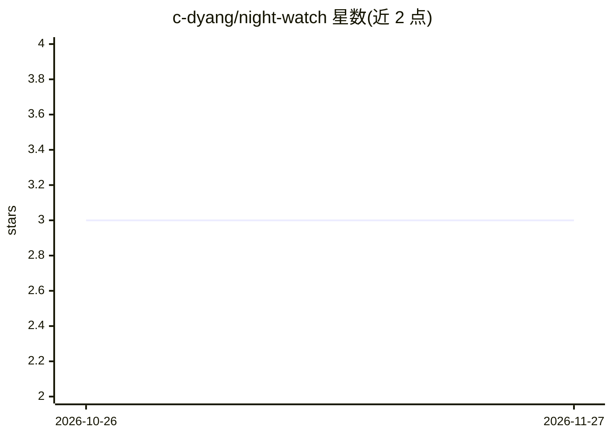

# c-dyang/night-watch

⭐ 3 · HTML · NOASSERTION · 推送 2026-11-22 · [GitHub](https://github.com/c-dyang/night-watch) · 个人维护 · 中文 README

**无人值守个人 agent 服务器的技术架构白皮书（中英双语）**

一份技术架构文档而非可安装软件，记录从'无限任务范围'与'单会话入口'两条硬性要求推导出的无人值守家庭 agent 服务器架构，覆盖记忆（四层金字塔）、执行（会话外判定与审计）、设备（信号与闸门）三个域，含 36 条带双维标注的不变量、20 个工程坑附录、事务台账与演化史。面向 AI 或指挥 AI 的人，中英双语，文档 CC BY 4.0、附录代码 MIT，由 AI 成文、作者审校。

## 筛选速览

| 维度 | 判定 | 备注 |
|---|---|---|
| AI 角色 | `ai-knowledge` | 知识聚合/清单类 |
| 许可风险 | `none` | NOASSERTION |
| 部署形态 | `None` |  |
| 模型依赖 | — | README 未给出锁定关系 |
| 硬件要求 | — | 无带数字的原话,不猜 |
| 安装摩擦 | `low` | 无编译、无系统依赖或容器化 |
| 成熟度 | `idea` | |

## 能力要点

- 36 条不变量按运行状态与证据强度双维标注（Q0–Q3）
- 四层金字塔记忆与会话外执行判定机制
- 20 个工程坑附录与 21 个真实触发事件的演化史
- 提供三条阅读路径与事务台账章节

## 适用场景

- 照着架构书搭建自己的无人值守个人 agent 服务器
- 参考不变量与工程坑清单设计长期运行的 agent 系统
- 按阅读路径快速判断架构是否适合自己场景

## 场景标签

 · 领域:AI 基础设施/架构文档

## 证据(README 行号)

> L38: 不是安装包，不是产品手册，是一份**技术架构书**：给 AI，或给"指挥 AI 的人"读。照着能搭出一个差不多的东西，实现不必一一对应 —— 换宿主、换模型、换语言都成立，只要守住不变量。
> L40: Not an installer, not a product manual, but a **technical architecture document** — for an AI, or for the person di
> L6: - 状态 Status：`v0.1-draft`（结构完整；**36 条不变量：受控量化 0 条 / 可追溯未量化 26 条 / 观察未量化 10 条** / 纯推理 0 条**）

## 星数曲线

2026-10-26 3 → 2026-11-27 3（+0）

---
*卡片 v1 · prompt 1.4 · 生成 2026-11-22 · 置信度 high · 依据 README sha `0640a72108a8` · [字段定义](../../DATASET.md)*
