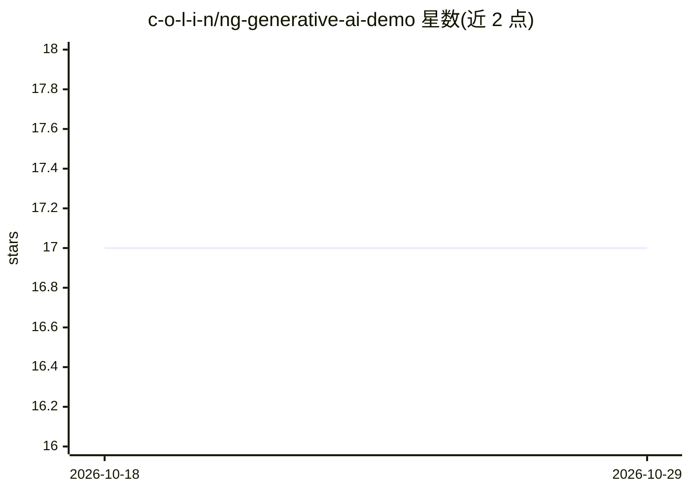

# c-o-l-i-n/ng-generative-ai-demo

⭐ 17 · TypeScript · 推送 2026-06-28 · [GitHub](https://github.com/c-o-l-i-n/ng-generative-ai-demo) · 个人维护

**Angular 演示应用：用 RxJS/Signals 流式展示 Gemini 回答**

一个 Angular 前端加 Node 后端的演示工程：后端 server.ts 调用 Google Gemini API，前端用 Angular Signals 管理聊天状态、用 RxJS Observables 接收实时文本流，HttpClient 以流式事件观察方式读取增量响应，并通过 ngx-markdown 渲染回答。面向想学习在 Angular 应用中集成 LLM API 与实时流式 UI 的前端开发者。需自备 Google AI Studio API key，以 .env 配置，前后端分别运行在 4200 与 3000 端口。

## 筛选速览

| 维度 | 判定 | 备注 |
|---|---|---|
| AI 角色 | `ai-native` | 本体是模型或模型工具 |
| 许可风险 | `none` | — |
| 部署形态 | `library` | 以包/库形式分发 |
| 模型依赖 | — | README 未给出锁定关系 |
| 硬件要求 | — | 无带数字的原话,不猜 |
| 安装摩擦 | `low` | 无编译、无系统依赖或容器化 |
| 成熟度 | — | 结构信号不足 |

## 能力要点

- Angular Signals 管理聊天状态（writable 与 computed 派生）
- RxJS Observables 处理 LLM API 的实时文本流
- HttpClient 事件观察与进度上报的流式读取配置
- ngx-markdown 渲染 AI 回答

## 适用场景

- 学习在 Angular 中集成 LLM API 的流式对话界面
- 参考 Signals 与 RxJS 管理实时生成状态的写法
- 作为自有 AI 聊天前端项目的起点代码

## 场景标签

`聊天机器人` · 领域:对话与助手

## 证据(README 行号)

> L7: Generative AI is changing the way we interact with technology. As AI chatbots become more commonplace, users expect 
> L23: 5. Run `npm run server` to start the backend server (`server.ts`) on port 3000.

## 星数曲线

2026-10-18 17 → 2026-10-29 17（+0）

---
*卡片 v1 · prompt 1.4 · 生成 2026-10-29 · 置信度 high · 依据 README sha `99e94d3ddc96` · [字段定义](../../DATASET.md)*
