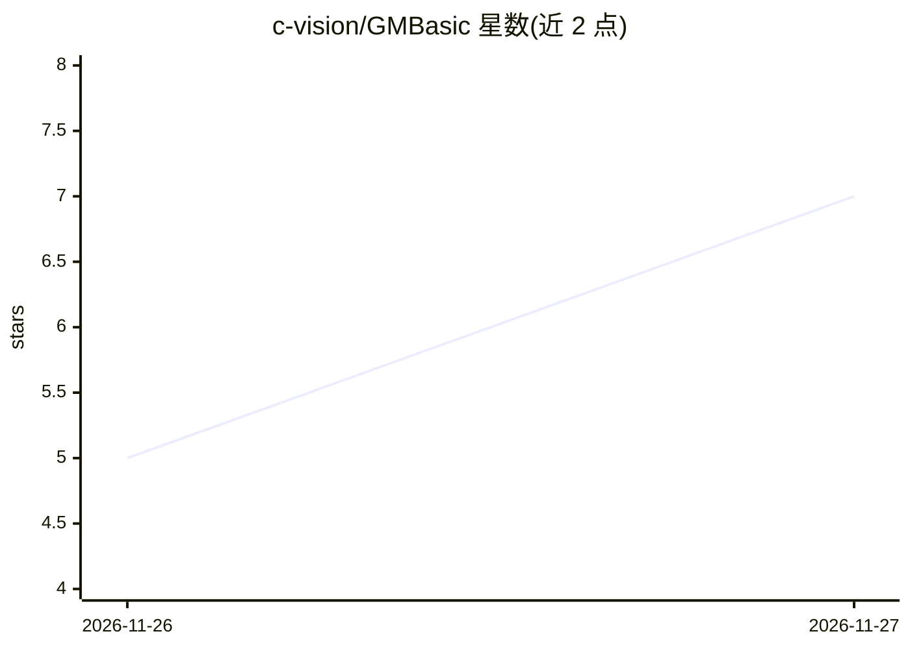

# c-vision/GMBasic

⭐ 7 · C · NOASSERTION · 推送 2026-11-26 · [GitHub](https://github.com/c-vision/GMBasic) · 个人维护

**面向开发者的 AI 增强 BASIC：四后端编译器+本地 LLM 栈**

一个带 500+ 内置函数的 BASIC 语言实现，C# 前端生成 P-Code，可由四种独立后端执行：C# P-Code VM、.NET IL、C 虚拟机、C99 转译为本地可执行文件。附带六个嵌入式数据库引擎（ISAM、DBF、SPEED、LEDGER、SQLite、VectorDB）、SDL2 图形、HTTP/WebSocket 服务器与本地 AI 栈：带工具调用的 agent、MCP 服务器与 52 个连接器、RAG/知识图谱 brains，以及带逐张量量化（q2_k…nvfp4 等）与训练（LoRA、DPO、蒸馏）的模型编译器。本地 LLM 推理由兄弟仓库 LLMEnv 提供 MLX 与 GGUF 后端。发布包目前仅覆盖 osx-arm64，无需 .NET 但需 cc 编译程序。

## 筛选速览

| 维度 | 判定 | 备注 |
|---|---|---|
| AI 角色 | `ai-ecosystem` | LLM/agent 周边工具 |
| 许可风险 | `none` | NOASSERTION |
| 部署形态 | `None` |  |
| 模型依赖 | local-ok | 支持本地模型 |
| 硬件要求 | — | 无带数字的原话,不猜 |
| 安装摩擦 | `high` | 编译与系统依赖俱全 |
| 成熟度 | — | 结构信号不足 |

## 能力要点

- 四个独立执行后端：PCodeVM、.NET IL、C VM、C99 转译器
- 模型编译器支持逐张量量化与 LoRA/DPO/蒸馏训练
- 六个嵌入式数据库引擎含原生 C 实现的 VectorDB
- 本地 AI 栈：agent 工具调用、MCP 服务器与 RAG brains

## 适用场景

- 在 Apple Silicon 上本地运行并微调 LLM
- 用 BASIC 编写带 RAG 与知识图谱的应用
- 构建可转译为 C99 本地可执行文件的程序

## 场景标签

`知识图谱` `RAG` `微调` `模型量化` · 领域:知识与检索

## 证据(README 行号)

> L9: > MCP server and 52 connectors, RAG and knowledge graphs (installable *brains*), a **model compiler
> L153: |**build**|`LLMEnv/tools/build_ai_libs.sh` builds the engine (`cmake -DLLMENV_BUILD_ENGINE=ON`, artifacts in `LLME
> L160: `GMBasic/gmbllm/` under the **PUL** license. The dependency is

## 星数曲线

2026-11-26 5 → 2026-11-27 7（+2）

---
*卡片 v1 · prompt 1.4 · 生成 2026-11-26 · 置信度 high · 依据 README sha `7f27132ff1dc` · [字段定义](../../DATASET.md)*
