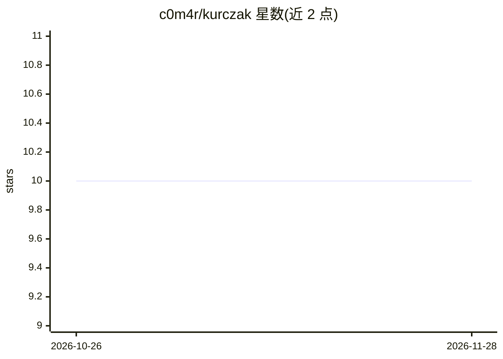

# c0m4r/kurczak

⭐ 10 · JavaScript · AGPL-3.0 · 推送 2026-11-06 · [GitHub](https://github.com/c0m4r/kurczak) · 个人维护

**面向本地用户的极简 Ollama 聊天界面：选模型即对话**

基于 Node.js/Express 的 Ollama 前端界面：从本地 Ollama 实例读取模型列表，支持流式输出、Markdown 与语法高亮、思维过程折叠展示、基于磁盘 JSON 的会话历史与三种行为模式（通用、小模型编码、结构化项目生成）。项目生成模式可捕获模型输出的完整文件块并打包为 ZIP 下载。无登录、无鉴权，README 声明仅适合本地使用或置于防火墙/VPN/反向代理之后。提供 REST API 代理与历史管理接口。

## 筛选速览

| 维度 | 判定 | 备注 |
|---|---|---|
| AI 角色 | `ai-ecosystem` | LLM/agent 周边工具 |
| 许可风险 | `viral` | AGPL-3.0 |
| 部署形态 | `self-host` | docker 或自建部署 |
| 模型依赖 | local-ok | 支持本地模型 |
| 硬件要求 | — | 无带数字的原话,不猜 |
| 安装摩擦 | `low` | 无编译、无系统依赖或容器化 |
| 成熟度 | — | 结构信号不足 |

## 能力要点

- 三种行为模式（General/Simple coder/Project builder）与可选提示词编辑器
- File Explorer 实时跟踪模型生成的项目文件并可导出 ZIP
- 流式输出、生成中切换会话、思维过程折叠查看
- 会话历史以磁盘 JSON 存储，无需数据库与登录

## 适用场景

- 为本地 Ollama 实例提供一个轻量聊天界面
- 用较小模型生成代码片段或用大模型生成完整项目
- 局域网/内网环境下部署私有聊天前端

## 场景标签

`聊天机器人` · 领域:对话与助手

## 证据(README 行号)

> L3: Minimal Ollama chat UI — no login, no heavy features. Pick a model and chat. Built for coding with markdown and synt
> L13: - **Model switcher** — Lists models from your Ollama instance
> L126: Kurczak provides a minimal REST API for interaction with Ollama and history management.

## 星数曲线

2026-10-26 10 → 2026-11-28 10（+0）

---
*卡片 v1 · prompt 1.4 · 生成 2026-11-19 · 置信度 high · 依据 README sha `8f40fd78a766` · [字段定义](../../DATASET.md)*
