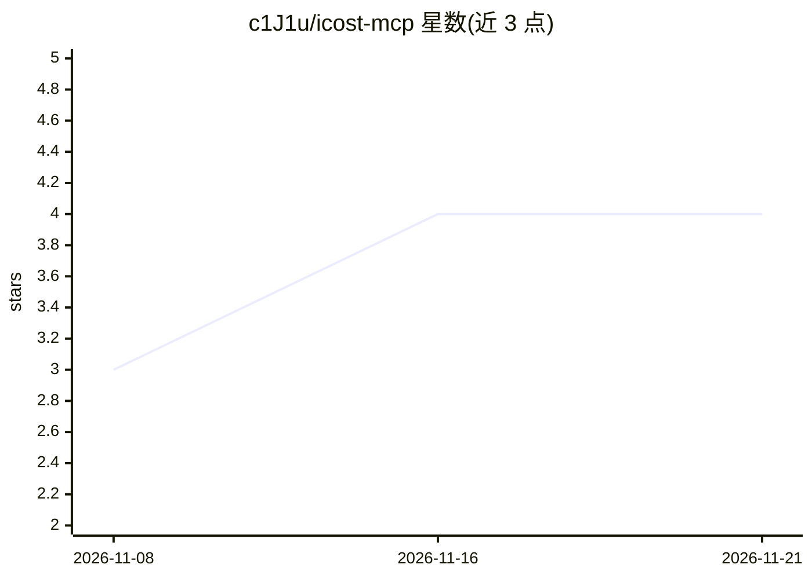

# c1J1u/icost-mcp

⭐ 4 · JavaScript · MIT · 推送 2026-10-19 · [GitHub](https://github.com/c1J1u/icost-mcp) · 个人维护 · 中文 README

**让 AI agent 经 MCP 读写 iCost 记账数据的 macOS 服务器**

非官方的 MCP 服务器，供 AI agent 在 macOS 上读取和写入 iCost 记账应用的本地数据，覆盖 38 个工具（记录增删改查、统计汇总、账户/分类/预算/模板管理等）。实现采用三种机制：只读 Realm 数据库快照、经应用官方 icost:// URL API 创建记录、以及复刻应用派生语义的直接数据库写入（修改/删除/管理操作）。删除为两步确认流程，含去重窗口、金额十进制字符串处理与本地离线运行。依赖特定 iCost 版本（4.7.1），应用更新可能使其失效。

## 筛选速览

| 维度 | 判定 | 备注 |
|---|---|---|
| AI 角色 | `ai-ecosystem` | LLM/agent 周边工具 |
| 许可风险 | `permissive` | MIT |
| 部署形态 | `library` | 以包/库形式分发 |
| 模型依赖 | — | README 未给出锁定关系 |
| 硬件要求 | — | 无带数字的原话,不猜 |
| 安装摩擦 | `low` | 无编译、无系统依赖或容器化 |
| 成熟度 | — | 结构信号不足 |

## 能力要点

- 38 个 MCP 工具覆盖记账全流程（记录/资产/预算/模板/统计）
- 三种写入机制：Realm 只读快照、官方 URL API、复刻应用语义的直接写库
- 两步删除确认（preview + 5 分钟内 confirm_token）与重复写入去重窗口
- 全部本地运行，无网络监听与遥测

## 适用场景

- 让 AI agent 查询和统计我的 iCost 账目数据
- 用自然语言指令代为记账、转账和修改记录
- 批量整理账户、分类、标签等记账元数据

## 场景标签

`数据分析` · 领域:效率与自动化

## 证据(README 行号)

> L3: An MCP server that lets an AI agent read and
> L16: 38 MCP tools covering the whole bookkeeping surface:

## 星数曲线

2026-11-08 3 → 2026-11-21 4（+1）

---
*卡片 v1 · prompt 1.4 · 生成 2026-11-21 · 置信度 high · 依据 README sha `cbbf378295b3` · [字段定义](../../DATASET.md)*
