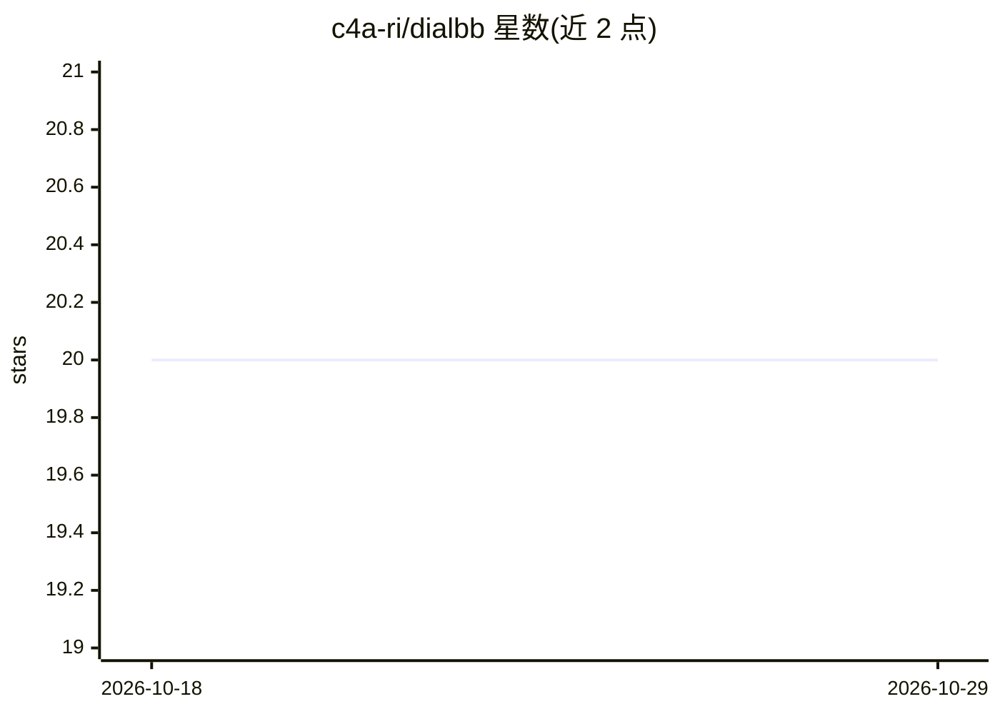

# c4a-ri/dialbb

⭐ 20 · Python · Apache-2.0 · 推送 2026-10-14 · [GitHub](https://github.com/c4a-ri/dialbb) · [官网](https://c4a-ri.github.io/dialbb/) · 组织维护

**对话系统开发框架：面向教学，含 LLM/DST/RAG 内置模块**

C4A 研究所开发的对话系统构建框架（v2.0.2），定位为教学材料，配套 SIGDIAL 2024 论文。应用由内置 block 组合而成：LLM 对话、LLM 对话状态跟踪（DST）+状态迁移网络（STN）、RAG 段落检索等；通过 dialbb-server 命令启动 HTTP 服务，提供浏览器对话界面。内置 block 默认使用 OpenAI ChatGPT，可经配置改用其他 LLM。附 LLM 用户模拟测试、辅助数据测试工具与无代码工具。运行环境为 Python 3.11–3.14（RAG 仅限 3.11–3.13）的 Windows/macOS/Ubuntu。

## 筛选速览

| 维度 | 判定 | 备注 |
|---|---|---|
| AI 角色 | `ai-ecosystem` | LLM/agent 周边工具 |
| 许可风险 | `permissive` | Apache-2.0 |
| 部署形态 | `desktop` | 安装包/桌面程序 |
| 模型依赖 | — | README 未给出锁定关系 |
| 硬件要求 | — | 无带数字的原话,不猜 |
| 安装摩擦 | `low` | 无编译、无系统依赖或容器化 |
| 成熟度 | — | 结构信号不足 |

## 能力要点

- 内置 block 组合构建对话应用（LLM 对话/DST+STN/RAG 检索）
- dialbb-sim-tester 提供 LLM 用户模拟测试
- dialbb-nc 无代码工具
- 默认接入 OpenAI ChatGPT，可通过配置改用其他 LLM

## 适用场景

- 学习对话系统构建流程与各功能模块
- 快速搭建基于 LLM 的问答/RAG 对话服务原型
- 用 LLM 用户模拟对对话应用做自动化测试

## 场景标签

`Agent 框架` `教程课程` · 领域:Agent 开发

## 证据(README 行号)

> L1: # DialBB: A Framework for Building Dialogue Systems
> L123: This application uses single prompt template for an LLM (Large Language Model) to engage in dialogues.
> L232: Sample RAG applications are available at `sample_apps/rag_en/` (English) and `sample_apps/rag_ja/` (Japanese). The

## 星数曲线

2026-10-18 20 → 2026-10-29 20（+0）

---
*卡片 v1 · prompt 1.4 · 生成 2026-10-28 · 置信度 high · 依据 README sha `5e7c0f2b0a15` · [字段定义](../../DATASET.md)*
