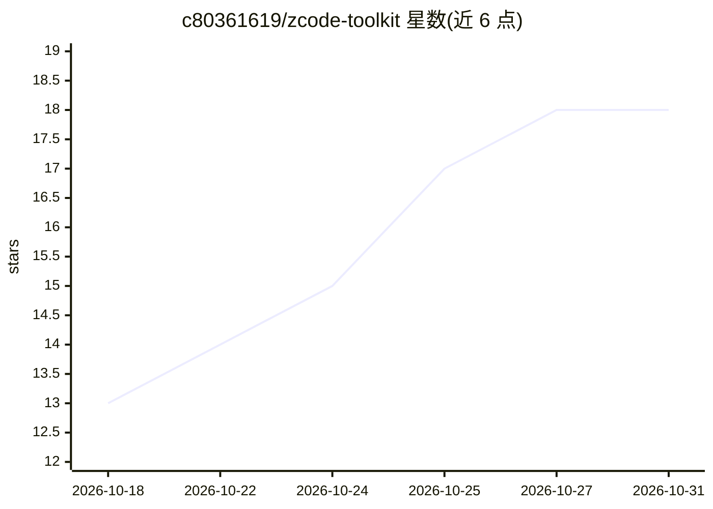

# c80361619/zcode-toolkit

⭐ 18 · Python · MIT · 推送 2026-10-19 · [GitHub](https://github.com/c80361619/zcode-toolkit) · 个人维护 · 中文 README

**ZCode 桌面客户端增强插件：TPS 状态栏、思考档位、提示词润色等**

为 ZCode 桌面客户端（Electron 应用）提供补丁式增强的插件套件，纯 Python 标准库实现、零第三方依赖、免编译。功能包括实时 TPS 与 Token 统计状态栏、思考强度悬浮滑条（3.14+ 原生 optionSpecs）、一键提示词润色（可右键自选润色模型）、用量图表去 Top 5/6 截断、设置页供应商模型拉取等。改动作用于本地客户端 app.asar 等文件，操作幂等、可逐项/全量还原，并带升级自愈看护机制（客户端升级后自动重打补丁）。实测支持 ZCode 3.11.2~3.15.1，通过插件市场、源码离线安装或纯 CLI 方式安装。

## 筛选速览

| 维度 | 判定 | 备注 |
|---|---|---|
| AI 角色 | `ai-enhanced` | 去掉 AI 部分产品仍成立 |
| 许可风险 | `permissive` | MIT |
| 部署形态 | `desktop` | 安装包/桌面程序 |
| 模型依赖 | — | README 未给出锁定关系 |
| 硬件要求 | — | 无带数字的原话,不猜 |
| 安装摩擦 | `low` | 无编译、无系统依赖或容器化 |
| 成熟度 | — | 结构信号不足 |

## 能力要点

- 对 app.asar 注入补丁：TPS 状态栏、思考滑条、用量图表去截断等增强
- 纯 Python 标准库、零第三方依赖、免编译，操作幂等且可精确还原
- 升级自愈看护：自动感知客户端/插件升级并静默重打补丁
- 提示词润色支持按供应商自选模型，失败时自动故障转移

## 适用场景

- 在 ZCode 桌面端常驻查看首 Token 延迟与生成速率等指标
- 拖拽滑条快速调节思考强度，替代手动改配置
- 全量查看所有模型的用量趋势，突破官方图表截断
- 客户端升级后自动恢复增强补丁，无需手动重装

## 场景标签

`提示工程` `LLM 可观测性` · 领域:Agent 开发

## 证据(README 行号)

> L9: 为 ZCode 桌面客户端补齐极致原生体验与生产力增强：
> L18: > **纯 Python 标准库驱动**：零第三方依赖、免编译；改动仅作用于**本地客户端文件**；
> L42: |📊|**实时 TPS 状态栏**|输入框常驻：本轮指标（首 token / tok/s / out）+ 会话累计，右键自由切换位置|`app.asar` 注入脚本|

## 星数曲线

2026-10-18 13 → 2026-10-31 18（+5）

---
*卡片 v1 · prompt 1.4 · 生成 2026-10-29 · 置信度 high · 依据 README sha `d066b17ba8f5` · [字段定义](../../DATASET.md)*
