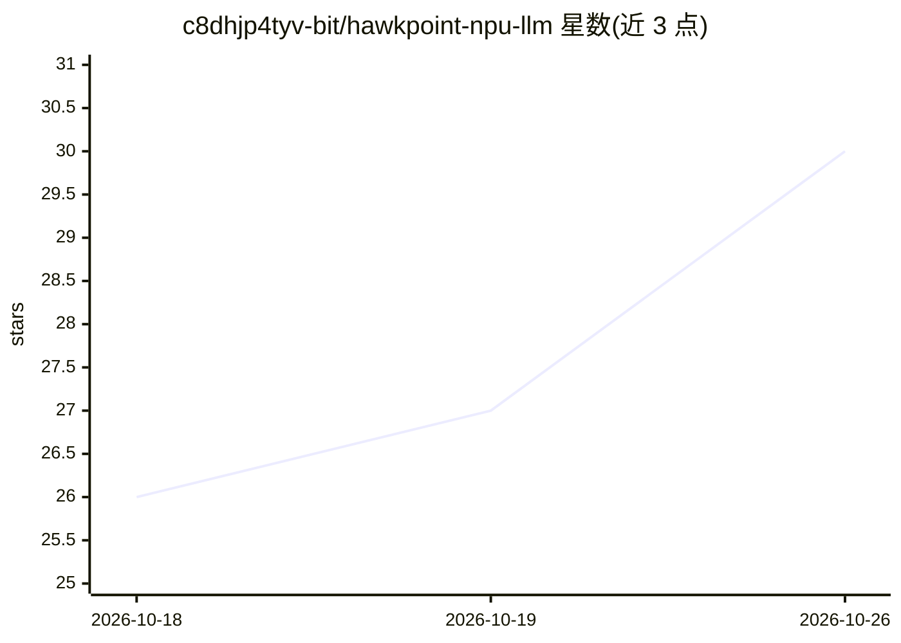

# c8dhjp4tyv-bit/hawkpoint-npu-llm

⭐ 30 · Python · NOASSERTION · 推送 2026-10-24 · [GitHub](https://github.com/c8dhjp4tyv-bit/hawkpoint-npu-llm) · 个人维护

**在 AMD XDNA1 NPU 上运行小模型推理的研究运行时**

面向 Phoenix/Hawk Point Ryzen AI 处理器第一代 XDNA NPU（npu1 AIE2 阵列）的实验性 LLM 推理项目，基于 MLIR-AIE/IRON 将 SmolLM 135M 与 Qwen2.5 0.5B 的解码层实现为 AIE2 内核。仓库含三条独立路径：原生 MLIR-AIE 运行时（附 OpenAI 兼容 API 服务器）、Ollama XDNA1 补丁（让 Ollama Qwen 模型跨 CPU/GPU/NPU 共享）、以及 Colibri 直连 C/XDNA 后端。限制：硬件上下文固定 64 token，仅支持四个特定 checkpoint，需自行搭建 MLIR-AIE 环境与匹配驱动/固件，作者声明非生产就绪且与 AMD 等无关联。

## 筛选速览

| 维度 | 判定 | 备注 |
|---|---|---|
| AI 角色 | `ai-ecosystem` | LLM/agent 周边工具 |
| 许可风险 | `none` | NOASSERTION |
| 部署形态 | `self-host` | docker 或自建部署 |
| 模型依赖 | local-ok | 支持本地模型 |
| 硬件要求 | — | 无带数字的原话,不猜 |
| 安装摩擦 | `low` | 无编译、无系统依赖或容器化 |
| 成熟度 | `idea` | |

## 能力要点

- 将 decoder projections/RMSNorm/RoPE/attention/KV cache/SwiGLU 实现为 AIE2 内核直接运行于 npu1
- Ollama XDNA1 补丁使 Ollama Qwen 模型跨 CPU、GPU、NPU 共享
- OpenAI 兼容 /v1/chat/completions API，支持流式、多候选、采样参数与 prefix 缓存
- 提供 Docker Compose 部署、Prometheus 指标端点与 Open WebUI 一键启动

## 适用场景

- 在 Ryzen AI 笔记本上让小参数模型占用 NPU 运行推理
- 给现有 Ollama 工作流接入 XDNA1 NPU 后端
- 研究 AIE2 阵列上 transformer 内核的部署与性能分析

## 场景标签

`推理引擎` · 领域:训练与推理

## 证据(README 行号)

> L3: Run compatible SmolLM 135M and Qwen2.5 0.5B transformer checkpoints on the
> L5: The implementation uses MLIR-AIE/IRON and targets the `npu1` AIE2 array
> L31: |Ollama XDNA1 patch|Existing Ollama Qwen models shared across CPU, GPU, and NPU|

## 星数曲线

2026-10-18 26 → 2026-10-26 30（+4）

---
*卡片 v1 · prompt 1.4 · 生成 2026-10-26 · 置信度 mid · 依据 README sha `f5b6fda8673a` · [字段定义](../../DATASET.md)*
