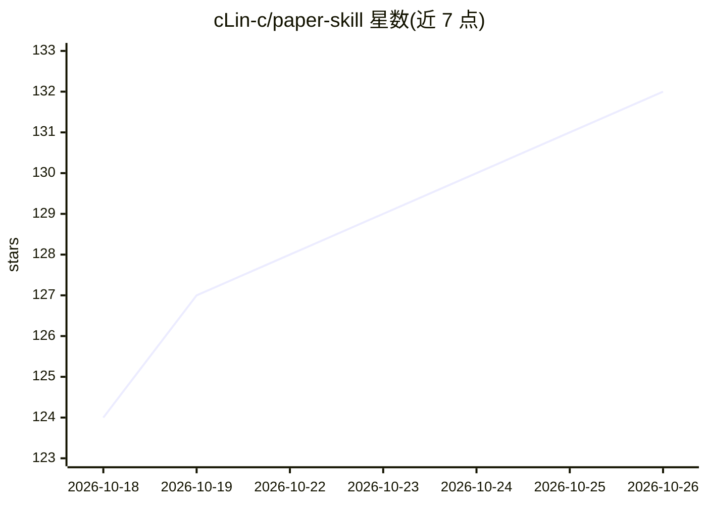

# cLin-c/paper-skill

⭐ 132 · Python · MIT · 推送 2026-09-26 · [GitHub](https://github.com/cLin-c/paper-skill) · 个人维护 · 中文 README

**面向中文科研作者的 evidence-first 英文论文投稿技能包**

运行于 Claude Code 等 slash-command 平台的论文写作技能（SKILL.md 路由 + 工作流）：把中文初稿、图表与参考文献转换为可核查的英文投稿材料，建立 claim–evidence map，明确拒绝编造数据与 DOI。提供 write/review/submit 三个入口，以及引用核验（Crossref/OpenAlex）、投稿门控、审稿回复一致性检查等可执行 Python 工具，输出 VERIFIED/UNVERIFIED 与 READY 门控判定。安装通过 curl/PowerShell 一行脚本，可选核验工具需 Python 3.10+。

## 筛选速览

| 维度 | 判定 | 备注 |
|---|---|---|
| AI 角色 | `ai-native` | 本体是模型或模型工具 |
| 许可风险 | `permissive` | MIT |
| 部署形态 | `None` |  |
| 模型依赖 | — | README 未给出锁定关系 |
| 硬件要求 | — | 无带数字的原话,不猜 |
| 安装摩擦 | `low` | 无编译、无系统依赖或容器化 |
| 成熟度 | — | 结构信号不足 |

## 能力要点

- write/review/submit 三入口：故事线、claim–evidence map、审稿回复矩阵、投稿门控
- Crossref/OpenAlex 核验 DOI 与文献，未核验内容标记 UNVERIFIED
- paper_skill_gate.py 等可执行工具做七项投稿门控与修订位置核对
- 公开确定性 benchmark（8/8 分类正确）与 Windows/Linux CI 测试

## 适用场景

- 把中文初稿转换为可核查的英文投稿稿件
- 投稿前审查引用、图表一致性与过度主张
- 撰写 Rebuttal、Cover Letter 并生成投稿包
- 核验审稿回复中声称的修改位置真实存在

## 场景标签

`科研工具` `AI 写作` · 领域:内容生成

## 证据(README 行号)

> L3: > 面向中文科研作者的 evidence-first 英文投稿工作流。
> L27: 把中文初稿、实验结果、图表和参考文献转换为可核查的英文投稿材料：
> L38: 它不是“帮我写得更像论文”的提示词合集。它把论文视为一套可追踪的主张、证据、引用、图表和投稿要求，并明确拒绝编造数据、实验、DOI、政策与修改位置。
> L107: |生成看起来真实的 DOI 或参考文献|Crossref/OpenAlex 核验；未核验内容明确标记 `UNVERIFIED`|

## 星数曲线

2026-10-18 124 → 2026-10-26 132（+8）

---
*卡片 v1 · prompt 1.4 · 生成 2026-10-22 · 置信度 high · 依据 README sha `9fe7167497b7` · [字段定义](../../DATASET.md)*
