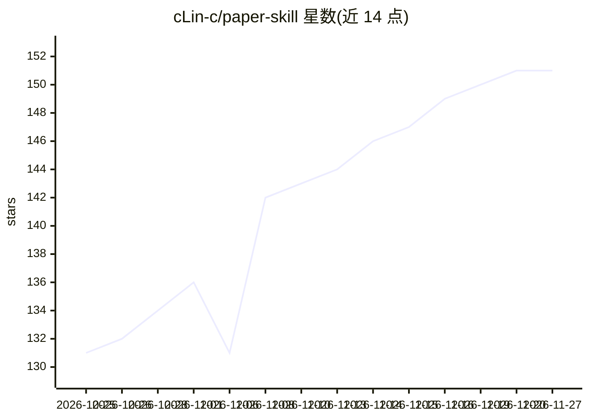

# cLin-c/paper-skill

⭐ 151 · HTML · MIT · 推送 2026-11-09 · [GitHub](https://github.com/cLin-c/paper-skill) · 个人维护 · 中文 README

**面向中文科研作者的学术论文写作与投稿 Claude Code 提示词技能**

以 Claude Code/Codex 技能形式安装的学术论文工作流：将中文初稿、实验结果、图表与参考文献转换为英文摘要、正文、Cover Letter 与投稿包。核心机制包括 claim–evidence map、Crossref/OpenAlex 引用核验、图表—正文一致性检查，以及 VERIFIED/UNVERIFIED 与 READY/NOT_READY 门控输出。附带 paper_skill_gate.py 等五个 Python 核验工具与 8 用例的确定性安全门控 benchmark，可选工具需 Python 3.10+。

## 筛选速览

| 维度 | 判定 | 备注 |
|---|---|---|
| AI 角色 | `ai-native` | 本体是模型或模型工具 |
| 许可风险 | `permissive` | MIT |
| 部署形态 | `None` |  |
| 模型依赖 | — | README 未给出锁定关系 |
| 硬件要求 | — | 无带数字的原话,不猜 |
| 安装摩擦 | `low` | 无编译、无系统依赖或容器化 |
| 成熟度 | — | 结构信号不足 |

## 能力要点

- write/review/submit 三个入口覆盖写作、审查、投稿回复流程
- paper-system 模块接入 88 条论文体系八步提示词
- Crossref/OpenAlex 核验 DOI，未核验内容标记 UNVERIFIED
- 配套 Python 门控工具与公开 benchmark（CI 在 Windows/Linux 运行）

## 适用场景

- 把中文初稿改写成可核查的英文期刊论文
- 投稿前核验引用、图表与正文的一致性
- 生成审稿逐点回复（Rebuttal/R&R）与 Cover Letter

## 场景标签

`科研工具` `AI 写作` · 领域:内容生成

## 证据(README 行号)

> L5: > 面向中文科研作者的 evidence-first 英文投稿工作流。
> L29: 把中文初稿、实验结果、图表和参考文献转换为可核查的英文投稿材料：
> L66: Claude Code 等 slash-command 平台可使用 `/paper-skill`。安装器只写入本机已存在的平台目录；若没有检测到平台，则默认安装到 Codex。可选的命令行核验工具需要 Python 3.10+。

## 星数曲线

2026-10-25 131 → 2026-11-27 151（+20）

---
*卡片 v1 · prompt 1.4 · 生成 2026-11-27 · 置信度 high · 依据 README sha `97055381a69b` · [字段定义](../../DATASET.md)*
