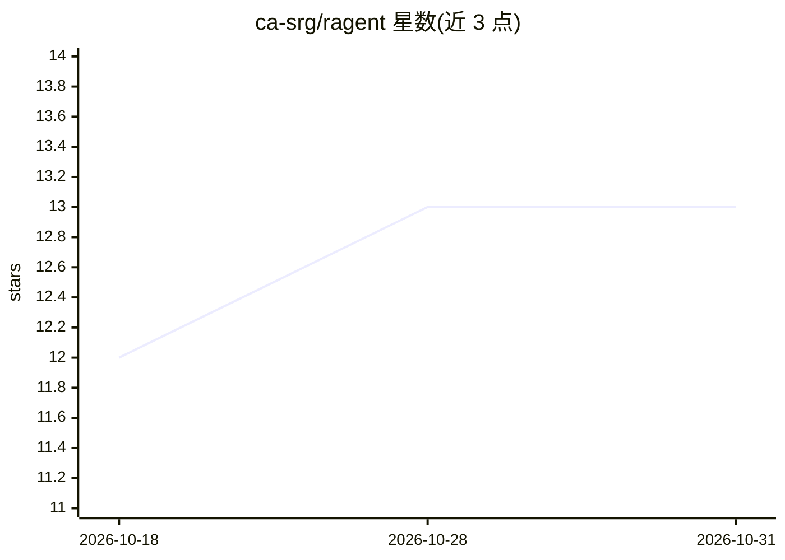

# ca-srg/ragent

⭐ 13 · Go · NOASSERTION · 推送 2026-07-15 · [GitHub](https://github.com/ca-srg/ragent) · [官网](https://ca-srg.dev) · 组织维护

**用 CLI 从 Markdown/CSV/PDF 构建 RAG 系统的工具**

Go 编写的 CLI 工具，将本地目录、S3、GitHub 仓库中的 Markdown/CSV/PDF 向量化（Bedrock 或 Gemini 嵌入），存储于 Amazon S3 Vectors，并通过 OpenSearch 提供 BM25+向量混合检索。提供五个主命令：vectorize、query、chat、slack-bot、mcp-server；Slack 搜索以嵌入无关方式在查询时实时拉取会话并融合文档结果。MCP Server 支持 Claude Desktop 接入，含 OIDC 认证、IP 访问控制与 AWS Secrets Manager 密钥注入。PDF 处理需指定 OCR 提供方，Slack 部分搜索模式需配置用户令牌。

## 筛选速览

| 维度 | 判定 | 备注 |
|---|---|---|
| AI 角色 | `ai-ecosystem` | LLM/agent 周边工具 |
| 许可风险 | `none` | NOASSERTION |
| 部署形态 | `desktop` | 安装包/桌面程序 |
| 模型依赖 | locked-api |  |
| 硬件要求 | — | 无带数字的原话,不猜 |
| 安装摩擦 | `low` | 无编译、无系统依赖或容器化 |
| 成熟度 | — | 结构信号不足 |

## 能力要点

- BM25+向量混合检索（OpenSearch 与 S3 Vectors）
- 多源摄取：本地/S3/GitHub 仓库
- 嵌入无关的 Slack 实时搜索与迭代查询精炼
- MCP Server、Slack Bot、OIDC 认证与 Secrets Manager 注入

## 适用场景

- 把团队文档与 Slack 会话整合为可检索问答系统
- 为 Claude Desktop 提供混合检索 MCP 工具
- 通过 CLI 批量向量化 Markdown/CSV/PDF 并执行查询

## 场景标签

`RAG` `文档问答` · 领域:知识与检索

## 证据(README 行号)

> L6: RAGent is a CLI tool for building a RAG (Retrieval-Augmented Generation) system from markdown documents using hybrid
> L112: RAGent provides five main commands, each serving a specific purpose in the RAG workflow:

## 星数曲线

2026-10-18 12 → 2026-10-31 13（+1）

---
*卡片 v1 · prompt 1.4 · 生成 2026-10-31 · 置信度 high · 依据 README sha `ef8188bf7418` · [字段定义](../../DATASET.md)*
